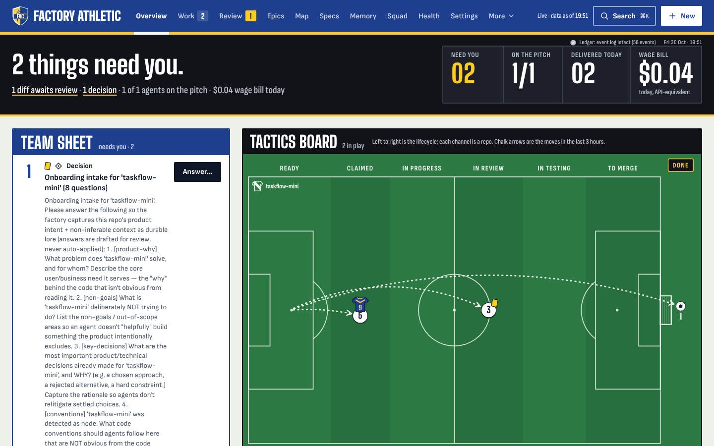
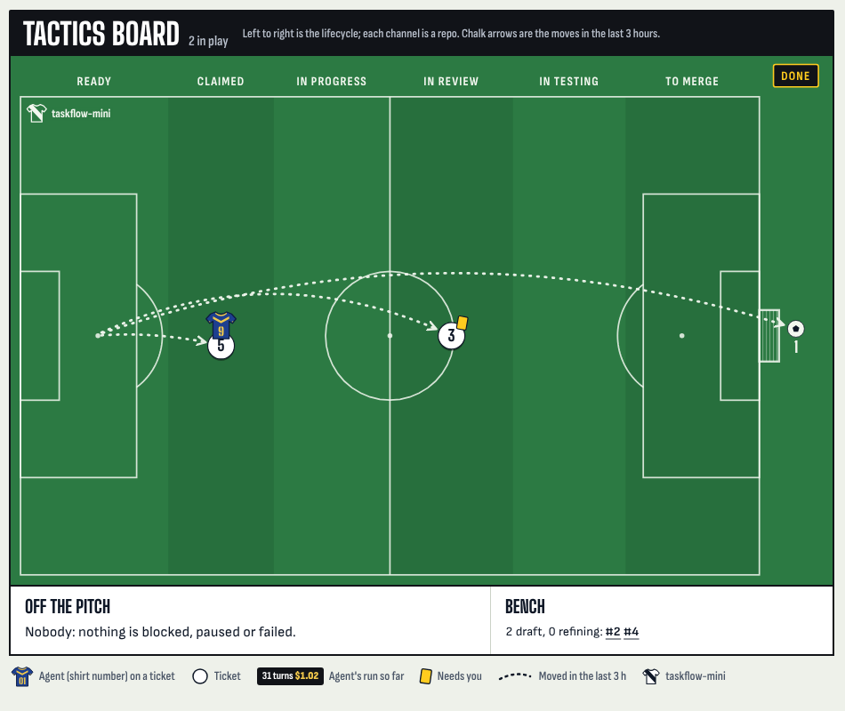
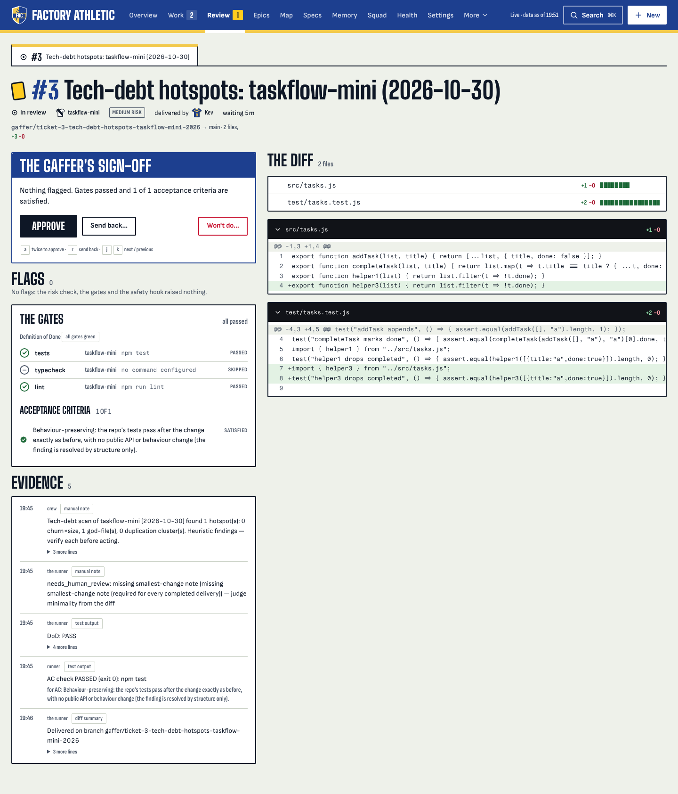
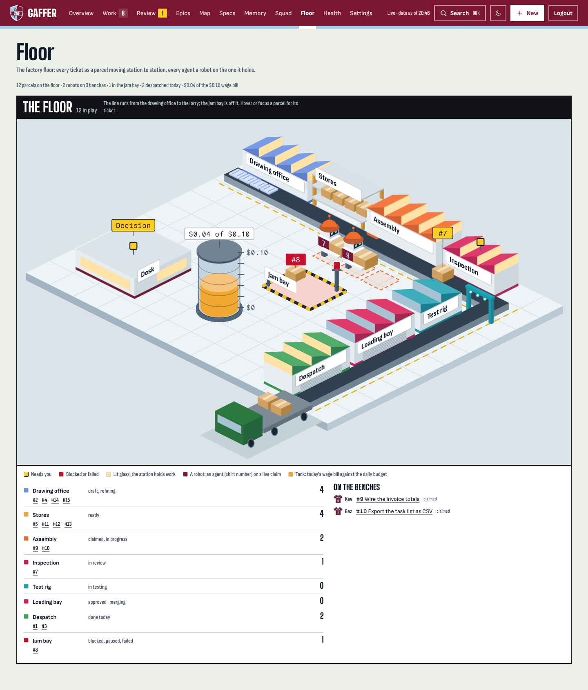

<!--
  Canonical GitHub repo topics (set these under repo → About → Topics for discoverability).
  Keep in sync with the "keywords" field in package.json.
  Apply with: gh repo edit tmj-90/gaffer --add-topic <topic> (one --add-topic per entry)
  ai-agent, coding-agent, ai-coding-assistant, agentic-ai, autonomous-agents, llm,
  claude, anthropic, developer-tools, local-first, self-hosted, human-in-the-loop,
  code-review, automation, typescript, cli
-->

# Gaffer

[](https://github.com/tmj-90/gaffer/actions/workflows/ci.yml)
[](https://opensource.org/licenses/Apache-2.0)



Gaffer is a software factory I run on my own machine. I give it tickets, or a one-line idea that it breaks into tickets, and it works through them in throwaway git worktrees while I get on with something else. When I come back there's a short list of diffs waiting for me, each with evidence that the tests really ran. Nothing merges until I've read the diff and approved it.

I built it for my side-project backlog. Every project I have carries a pile of tickets that are worth doing and never urgent: the flaky test I keep re-running, or docs that drifted months ago. I wanted to hand that pile to something that would plod through it carefully and stop to ask when it got stuck.

Claude Code does the coding. Gaffer is the rest of the job: the queue and the order things happen in, the checks the agent can't mark itself, what it remembers about each repo, and the gate where a person decides what lands.

It's alpha. It gives an agent a shell inside the repos you point it at, so keep it to repos you trust and read [SECURITY.md](SECURITY.md) before you loosen any of its defaults.

## How a ticket gets done

A ticket can't be marked ready until it has at least one acceptance criterion; the stricter policy packs (`team_light` and up) also require a repo it's allowed to write to. Under the default `solo_loose` pack a ticket with no write repo goes ready with a warning, and the runner parks it as blocked for you (reason `no_write_repo`) instead of delivering it. A criterion can carry a check command (`--check "npm test"`), which the runner runs itself rather than taking the agent's word for it.

`gaffer run` makes one pass over the ready queue and then exits. There's no daemon unless you ask for one. Each tick claims a ticket, creates a worktree on a `gaffer/ticket-<n>-<slug>` branch, and starts a headless agent session there with the skills that suit the ticket. The agent reaches the control plane and the memory store over MCP, and the safety hook sees every tool call it makes. Your own checkout is never touched.

When the agent says it's finished, the runner runs the repo's tests, typecheck and lint in the worktree, then every criterion's check command. A failure goes back for rework with the output attached. After three attempts (`GAFFER_MAX_DELIVERY_ATTEMPTS`) the ticket is parked as blocked and waits for me.

A delivery that passes sits in review. The diff you approve is computed by the control plane from git, so it shows what actually changed, whatever the agent says. Approving pins the commit you read and sends it towards merge (through the independent tester first, if it's an Acceptance ticket); an approval of a branch that moved after the diff loaded is refused, and nothing lands a branch that moved after the approval. Merging is a separate click unless you turn on `AUTO_MERGE`. Before anything lands, Gaffer builds the merge of the approved commit onto your current default branch and runs your repo's gates on that merge, because two branches that each pass can still combine into something that fails. Only a passing combination lands, and only while the default branch is still the one it tested; a failing one waits for you with the gate output, and your default branch is untouched. A ticket that spans several repositories lands one gated merge per repository and is done only when every repository's change has landed. With CI required, nothing is approved until CI has passed for the commit you are approving. Landing also refreshes what Gaffer knows about the repo. By default no agent reviews anything (`REVIEW_MODE=human`). If you do let agents approve, the control plane still refuses an approval from the agent that did the work.

Models are tiered in [runner/model-registry.json](runner/model-registry.json), which maps each tier to a model. Planning runs on the strong tier and implementation on the mid tier by default. A low-risk ticket with at most one criterion, or one measured as a small change, is implemented and tested on the cheap tier; a high-risk ticket or one with a lot of criteria is routed a tier up.

### Planning a build

In the dashboard, "Plan a build" takes a one-line brief and has a short conversation about it. It usually asks a few clarifying questions first, then proposes an epic of tickets, each with its own criteria, target repo and `dependsOn` edges, so the API can wait for the data model and the docs can come last. Nothing is created until you confirm, and you can create the tickets as drafts to look them over first. If there's no repo yet, the plan starts with a bootstrap ticket that creates one.

Every epic also gets an Acceptance ticket that depends on all the others. An independent tester checks the brief end to end against the merged build, working from the brief and the criteria without seeing the diff. Its pass is bound to the commit it tested, so a build where every ticket merged still isn't reported as accepted until that pass exists. Planning is dashboard-only for now.

### What it remembers

Onboarding a repo writes a digest of it (overview, structure, conventions, stack), a feature ledger, and draft lore, which is notes on conventions and gotchas cited back to the code. Each merge moves the ledger on and refreshes the digest, so the next ticket starts from what the last one learned. Every delivery prompt is primed from that memory: the file cards that match the ticket, the repo's approved conventions and gotchas recalled for it, and its product decisions, requirements and non-goals. The agent can pull more cards and lore over its memory MCP server. Lore an agent suggests lands as a draft, and delivery agents can't see drafts until a human approves them (dashboard or memory CLI). The digest is only a summary, and the tool that hands it to an agent says to check the code before high-stakes work.

## What still needs you

Out of the box Gaffer is supervised, and these jobs stay with a person:

- reading and approving each diff, then merging it
- answering decisions, including the intake questions onboarding files about each repo
- writing tickets, or confirming the ones a plan proposes, and marking them ready
- unblocking tickets that ran out of attempts
- approving or rejecting lore drafts

Every flag that hands one of these to an agent is off by default. `GAFFER_MODE` sets them as a group (`supervised`, `lite`, `graduated`, `autonomous`, `strict`) and the individual flags override it. [docs/CONFIG.md](docs/CONFIG.md) lists every setting and its default.

## Getting started

You'll need:

- macOS or Linux. CI runs both; I don't test Windows.
- Node 22.22.1 or newer. That's the floor in `package.json`, and `.npmrc` sets `engine-strict=true`, so pnpm refuses anything older. Node 22.22.0 is one patch short, and setup says so before it installs anything.
- pnpm 10.33.0, pinned in `packageManager`
- git
- the Claude Code CLI (`claude`), installed and logged in, for any live run. Setup, the demo and dry runs work without it, and onboarding falls back to a mechanical scan.

Set up, start the dashboard and onboard a repo:

```bash
git clone https://github.com/tmj-90/gaffer && cd gaffer
runner/gaffer setup                       # install, build, create .gaffer/, start the dashboard
runner/gaffer onboard ~/code/your-repo    # register it, scan it, write its digest and draft lore
runner/gaffer status                      # what's registered, and anything waiting on you
```

`setup` prints a `http://127.0.0.1:8787/?token=…` link. The dashboard listens on loopback unless you start it with `runner/gaffer dashboard --lan`, and every data request needs that token either way. Factory state, including the databases and that token, lives in `.gaffer/` inside the checkout. Delete it to start again.

Give it a first ticket. `runner/gaffer wg` is the control-plane CLI pointed at this factory's database:

```bash
runner/gaffer wg ticket create -t "Add listNotes" -d "Export listNotes(notes) from src/notes.js, newest first, input untouched."
runner/gaffer wg ac add 1 -t "listNotes returns a new array sorted newest-first"
runner/gaffer wg ac add 1 -t "the test suite passes" --check "npm test"
runner/gaffer wg ticket repo-access set 1 your-repo   # the name onboard registered
runner/gaffer wg ticket ready 1
```

If **ready** is refused, the refusal names what's missing, and `wg ticket edit 1` (title, description, policy) or `wg ac edit 1 <ac>` / `wg ac rm 1 <ac>` fixes it. A ticket's contract is editable until it is claimed; after that the review and the tester are held to it.

Then watch it, and let it go when you're happy:

```bash
runner/gaffer demo                         # the whole loop on a throwaway showcase repo, dry run
runner/gaffer run --dry-run                # what a pass over your queue would do; nothing spent
export GAFFER_DAILY_BUDGET_USD=5           # a live run refuses to start without a dollar cap
runner/gaffer run                          # live: one pass, delivers ready tickets to review
runner/gaffer approve 1 --reviewer <you>   # the human gate, or use the Review screen
runner/gaffer merge 1
```

`runner/gaffer run --daemon` repeats the pass every 30 seconds (`--interval` changes that) until you stop it. If the model's usage window runs out, the ticket goes back to Ready without counting an attempt and the daemon sleeps until the window resets (`gaffer status` says until when). Read `runner/factory.config.sh` before the first live run. It's where the defaults live, and a live run spends real money.

To run it in a container instead, export `ANTHROPIC_API_KEY` (or `CLAUDE_CODE_OAUTH_TOKEN`), put the repos you want worked on under `./repos`, and run `docker compose up -d`. The dashboard comes up on `127.0.0.1:8787` and `docker compose logs dashboard` shows the login link.

[quickstart.md](quickstart.md) is the long version, with the greenfield path and the first-run gotchas.

## The dashboard



A gaffer is the manager, so the dashboard is match day. The Overview opens on a scoreboard showing how many things need you, how many agents are on the pitch, what's been delivered today and the wage bill against the daily budget. Beside it is the Team Sheet, a numbered list of everything waiting on you with one action on each row. The Tactics Board is a drawn pitch with the ticket lifecycle running left to right and one channel per repo. Each agent is a numbered shirt standing on the ticket it holds, and chalk arrows show the moves of the last three hours. Review becomes The Gaffer's Sign-off, with the flags, the gates, the acceptance criteria and the diff on one screen. Under the title, a verdict strip puts what the runner recorded above what the agent wrote: each gate and the command it ran, the test count the runner saw, the tester's verdict, cost and turns, the attempt and its rework, the risk reasons and the reviewed-commit pin. Each acceptance criterion shows the runner's exit code or "no machine evidence", and an agent summary that claims a whole-suite test count the runner didn't see is flagged.



You can name the club and the squad. With the full token, click the crest at the top left to open Name your club: the club name, the crest's short name (up to four characters) and the two kit colours, with a preview of the crest and a shirt. The kit colours dress the header, the crest and every agent's shirt, and a kit too light for white text gets dark text on it instead. The Squad page (after Memory in the nav, or under More when the header is full) lists every agent with its shirt number, name, role, the name it registered with, status and when it was last seen. Rename on a row sets a display name of up to 40 characters and a shirt number from 1 to 99, and a number another agent wears is refused with that agent's name. Until you rename one, an agent goes by a default such as "Delivery 1" or "Reviewer". The Tactics Board, the Team Sheet, the work board, Review, a ticket's timeline, Squad & form and Health all show an agent by that name and number. From a terminal, `runner/gaffer wg club set --name "…" --short ABC --kit-primary "#7a1f3d" --kit-secondary "#8ec5e8"` does what the crest does, `runner/gaffer wg agent list` shows each agent's id, and `runner/gaffer wg agent rename <id> --name "…" --number 9` does what Rename does. The same data is served at `/api/club` and `/api/squad`. A read-only token sees the names and the crest but gets no editors. Anywhere else in the dashboard a read-only token sees one "Read-only access" strip under the header, and the controls that would change something (Settings' editors and Save, Poll for work, a card's Move, a ticket's actions, the Team Sheet's buttons) are switched off with a title that says why. Names are only for show. An agent's id, which is what claims and the event log record, never changes, and agents can't rename themselves or the club.

The Floor (after Squad in the nav, or under More) draws the factory as an isometric factory floor, live. A conveyor runs past the stations in lifecycle order: the drawing office (drafts and refining), Stores (ready), Assembly (claimed and in progress), Inspection (in review), the test rig, the loading bay (approved, waiting to merge) and Despatch, where a lorry carries what was done today. Every open ticket is a parcel at its station, and every live claim is a robot wearing its agent's shirt number, the same number and name as on the Tactics Board. Blocked, paused and failed tickets sit in a hazard-taped jam bay whose beacon lights while anything is in it, and a spend tank is filled to today's wage bill against the daily budget. It reads the same data as the Overview and redraws on the live stream. Every parcel, robot and station is a link, a parcel's label reads as a sentence ("#12 Fix the login redirect, in review, delivered by Kev (No. 9)"), and hovering or focusing one shows its number and title. Under the drawing, each station's tickets and who is on the benches are listed as text.



The other screens cover the work board, epics drawn as dependency graphs, the Factory Map of repos and scopes, specs, memory, health (what it cost and where it failed) and settings. [docs/FEATURES.md](docs/FEATURES.md) goes through them.

## Safety

Every agent tool call goes through a deterministic PreToolUse hook, [runner/safety-hook.mjs](runner/safety-hook.mjs). It keeps writes inside the ticket's worktree, refuses reads of secret files and credential stores, stops the agent driving the control plane or its databases directly, and blocks when it can't prove a target is in scope. The agent starts from an allowlisted environment with token and key variables stripped. The review gate lives in the control plane, so an agent can't argue its way past it.

The runner decides "done" by running the repo's own tests, lint and typecheck, so it also checks the agent hasn't weakened them. Gate commands that call a package.json script run the script from the commit the delivery branched from. A delivery that deletes or renames a test, adds a `.skip`/`.only`/`xfail`/`t.Skip`, or changes a gate script (an added `pretest` hook included) is flagged on the Sign-off, and an agent can't approve it. The check compares against the commit the runner recorded when it cut the branch, not the base branch name, and a retry keeps that commit. Only you can allow test changes on a ticket (`gaffer wg ticket allow-test-changes <n>`); that clears the flag but the gate still runs the base commit's scripts. For now it flags and never fails a delivery.

The hook is a string analyser for bash, and a determined agent that builds paths at runtime can get further than I'd like. That's why anything that lets an agent ship work defaults `GAFFER_STRICT_REQUIRE=1`, which refuses to launch an agent without an OS sandbox. That covers the `DISPATCH_ALLOW_AGENT_APPROVE`, `MERGE_ON_AGENT_REVIEW`, `AUTO_MERGE` and `MEMORY_AUTO_APPROVE` flags, the modes that set them, and a per-repo policy that lets a repo ship unattended. `SANDBOX_PROVIDER=docker` gives read and egress isolation on any host with Docker. macOS `sandbox-exec` only restricts writes.

Work is capped at 50 ticks a day (`MAX_TICKS_PER_DAY`), and a live run won't start without a dollar cap: set `GAFFER_DAILY_BUDGET_USD` for the day or `GAFFER_BUDGET_USD` for the factory's lifetime (no new paid work starts at $0 headroom). `gaffer run`, the loop and the dashboard's Poll for work all refuse until one is set, and the dashboard's first Poll asks for a daily budget, prefilled at $5. `GAFFER_ALLOW_UNCAPPED=1` opts out. `GAFFER_MAX_CALL_USD` caps a single agent call. [SECURITY.md](SECURITY.md) has the threat model and the limits in full.

## What's rough

- The Match Day dashboard described above is still on a branch, so the merged UI looks different for now.
- The docker sandbox is experimental. Its containment is red-team tested in CI, but a full live delivery inside the container hasn't been proven yet.
- Only one worker is supported (`GAFFER_WORKER_PROVIDER=claude-code`). The seam for others exists, but any other value refuses to run.
- REST credentials are per principal (`runner/gaffer wg principal create`) and can be read-only, but there's no per-repo or per-ticket permission. On the CLI the actor is whatever `$USER` says.
- Planning a build needs the dashboard, and approving lore needs the memory CLI (`MEMORY_DB=.gaffer/memory.sqlite node packages/memory/dist/bin/memory.js review`).
- Greenfield runs have a few first-run steps, covered in [quickstart.md](quickstart.md#greenfield-gotchas-things-you-currently-have-to-do). Read them before you start one.
- The eval judge that scores each delivery is opt-in (`GAFFER_EVAL_JUDGE=1`) while I find out whether its scores are worth having. See [docs/eval-harness.md](docs/eval-harness.md).

## Layout

```
gaffer/
├── packages/
│   ├── dispatch/   control plane: SQLite, REST, MCP, the dashboard, and the CLI behind `gaffer wg`
│   ├── crew/       factory runtime: onboarding, context packets, hooks, idle loops, MCP tools
│   └── memory/     lore and repo memory: digest, feature ledger, gated lore (memory-mcp)
├── runner/         the live runtime: tick.sh, loop.sh, the safety hook, 118 skills
├── docs/           configuration reference, feature tour, design notes
└── quickstart.md
```

`runner/gaffer skills install` links the skill library into `.claude/skills` in the current directory (`--user` for `~/.claude/skills`), and `runner/gaffer skills add <path|git-url>` validates an outside skill against the same lint gate the bundled library passes (a known `area`, a trigger-phrased description, a real procedure, real MCP tool names) before adding it to the factory's library.

## Further reading

- [quickstart.md](quickstart.md): the guided first run
- [docs/FEATURES.md](docs/FEATURES.md): each surface in more detail
- [docs/CONFIG.md](docs/CONFIG.md): every setting, generated from the code
- [SECURITY.md](SECURITY.md): threat model and residual limits
- [ARCHITECTURE.md](ARCHITECTURE.md): how the pieces fit together
- [runner/README.md](runner/README.md) and [runner/RUNBOOK.md](runner/RUNBOOK.md): the runner in depth
- [docs/openapi.json](docs/openapi.json): the REST contract, also served at `GET /api/openapi.json`
- [docs/RELEASING.md](docs/RELEASING.md): how releases are cut
- [CHANGELOG.md](CHANGELOG.md)

## Contributing

Issues and pull requests are welcome. [CONTRIBUTING.md](CONTRIBUTING.md) has the ground rules. The first one is that a change loosening the safety hook gets rejected. `pnpm check` runs the TypeScript side and `pnpm test:runner` runs the runner's tests, the same way CI does.

## Credits

Some skill packs are adapted from MIT-licensed work: [ui-ux-pro-max-skill](https://github.com/nextlevelbuilder/ui-ux-pro-max-skill) for the design-system, frontend-design and brand packs, [alirezarezvani/claude-skills](https://github.com/alirezarezvani/claude-skills) for devops, marketing, product and docs packs, and [Matt Pocock's skills](https://github.com/mattpocock/skills) for the caveman compressed-communication pattern. Their licence texts are in [THIRD_PARTY_NOTICES.md](THIRD_PARTY_NOTICES.md).

## Licence

Apache-2.0. See [LICENSE](LICENSE) and [NOTICE](NOTICE). Gaffer is an independent project and isn't affiliated with or endorsed by Anthropic. Claude and Claude Code are trademarks of Anthropic PBC.
