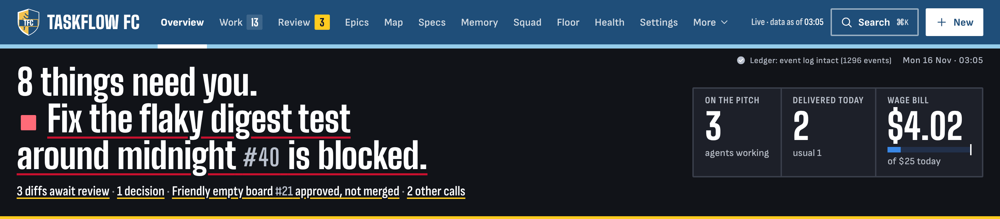

# Gaffer



Gaffer is a software factory I run on my own machine. I give it tickets, or a one-line idea that it breaks into tickets, and it works through them in throwaway git worktrees while I get on with something else. When I come back there's a short list of diffs waiting, each with evidence that the tests really ran. Nothing merges until I've read the diff and approved it.

Claude Code does the coding. Gaffer is the rest of the job: the queue, the checks the agent can't mark itself, what it remembers about each repo, and the gate where a person decides what lands.

It's alpha, and it gives an agent a shell inside the repos you point it at. Keep it to repos you trust, and read [SECURITY.md](SECURITY.md) before you loosen a default.

## How a ticket gets done

1. **Scout.** Before any agent starts, the runner works out where the change probably lands and how risky it is.
2. **Delivery.** An agent works in a fresh worktree on its own branch. Your checkout is never touched.
3. **Gates.** The runner runs the repo's tests, typecheck and lint itself. A failure goes back for rework, and after three attempts the ticket is parked for you.
4. **Tester.** Where it applies, an independent tester writes black-box tests against the ticket's criteria, and the runner replays them on a clean checkout.
5. **Review.** You read the real git diff, with what the runner recorded above it, and approve it or send it back.
6. **Landing.** Merging is a separate step. Gaffer builds the merge onto your current default branch and runs the gates on that before anything lands.

[docs/FEATURES.md](docs/FEATURES.md) covers each step, the dashboard, planning a build from a one-line brief (with optional web research first), and what Gaffer remembers about a repo.

## Getting started

You need macOS or Linux, Node 22.22.1 or newer, pnpm 10.33.0 and git. A live run also needs the Claude Code CLI (`claude`), logged in, and an OS sandbox: `sandbox-exec` on macOS (already there), Docker on Linux.

```bash
git clone https://github.com/tmj-90/gaffer && cd gaffer
runner/gaffer setup                       # install, build, create .gaffer/, start the dashboard
runner/gaffer onboard ~/code/your-repo    # register it, scan it, write its digest and draft lore
runner/gaffer status                      # what's registered, and anything waiting on you
```

`setup` prints the dashboard link (`http://127.0.0.1:8787/?token=…`). For another port, `export DISPATCH_API_PORT=9000` first. To type `gaffer` instead of `runner/gaffer`, add `alias gaffer="$PWD/runner/gaffer"` to your shell profile.

Give it a ticket:

```bash
runner/gaffer wg ticket create -t "Add listNotes" -d "Export listNotes(notes) from src/notes.js, newest first, input untouched."
runner/gaffer wg ac add 1 -t "the test suite passes" --check "npm test"
runner/gaffer wg ticket repo-access set 1 your-repo   # the name onboard registered
runner/gaffer wg ticket ready 1
```

Then run it:

```bash
runner/gaffer run --dry-run                # preview each ready ticket; nothing claimed or spent
export GAFFER_DAILY_BUDGET_USD=5           # a live run refuses to start without a dollar cap
runner/gaffer run                          # one pass: delivers ready tickets to review
runner/gaffer approve 1 --reviewer <you>   # or use the Review screen
runner/gaffer merge 1
```

A live run spends real money. [quickstart.md](quickstart.md) is the long version, including Docker and starting from an idea instead of a repo.

## Configuration

A factory has fourteen settings. Most people set three:

- `GAFFER_MODE`: who approves and merges (`supervised` by default: a person approves every merge)
- a budget: `GAFFER_DAILY_BUDGET_USD` for the day, or `GAFFER_BUDGET_USD` for the factory's lifetime
- `GAFFER_MODELS`: the strong, standard and cheap models (opus, sonnet and haiku by default)

Set them in the dashboard's Settings, in `.gaffer/settings.json`, or as environment variables. [docs/CONFIG.md](docs/CONFIG.md) has all fourteen.

## Safety

Every agent tool call goes through a deterministic hook that keeps writes inside the ticket's worktree and refuses reads of secrets. Every agent runs inside an OS sandbox or doesn't run at all. The runner decides "done" by running the repo's own tests, and flags a delivery that weakened them. The review gate lives in the control plane, so an agent can't approve its own work.

None of that makes it safe to point at a repo you don't trust. [SECURITY.md](SECURITY.md) has the threat model and the limits.

## Layout

```
gaffer/
├── packages/
│   ├── dispatch/   control plane: SQLite, REST, MCP, the dashboard, and the CLI behind `gaffer wg`
│   ├── crew/       factory runtime: onboarding, context packets, hooks, idle loops, MCP tools
│   └── memory/     lore and repo memory: digest, feature ledger, gated lore (memory-mcp)
├── runner/         the live runtime: tick.sh, loop.sh, the safety hook, 118 skills
├── docs/           the docs index, configuration reference, feature tour, guides
└── quickstart.md
```

## More

- [docs/README.md](docs/README.md): every doc, by what you need
- [ARCHITECTURE.md](ARCHITECTURE.md): how the pieces fit together
- [docs/testing.md](docs/testing.md): running the tests (`pnpm check`, `pnpm test:runner`)
- [runner/RUNBOOK.md](runner/RUNBOOK.md): the runner in depth
- [CHANGELOG.md](CHANGELOG.md)

## Licence

Apache-2.0. See [LICENSE](LICENSE) and [NOTICE](NOTICE). Some skill packs are adapted from MIT-licensed work, credited in [THIRD_PARTY_NOTICES.md](THIRD_PARTY_NOTICES.md). Gaffer is an independent project and isn't affiliated with or endorsed by Anthropic. Claude and Claude Code are trademarks of Anthropic PBC.
