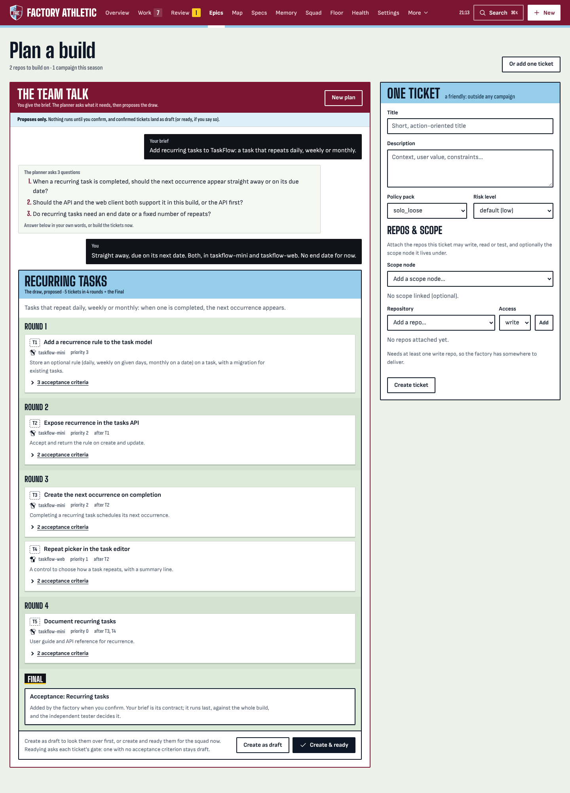
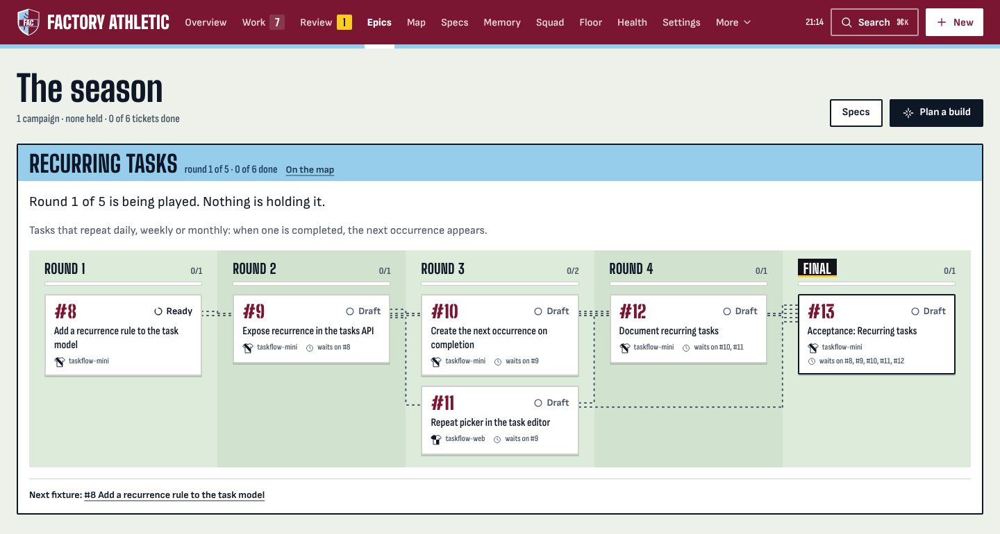
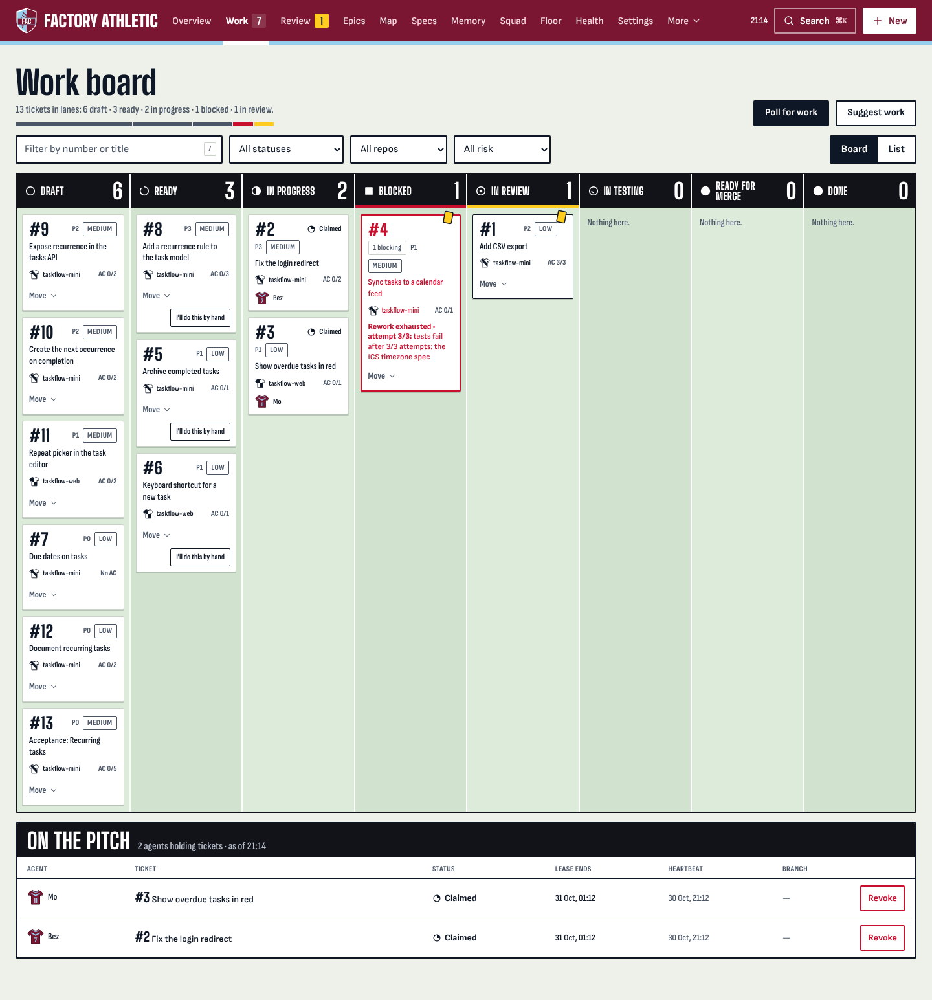
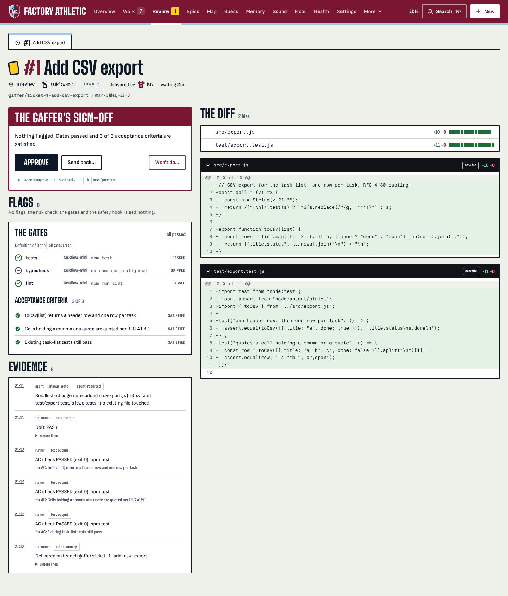
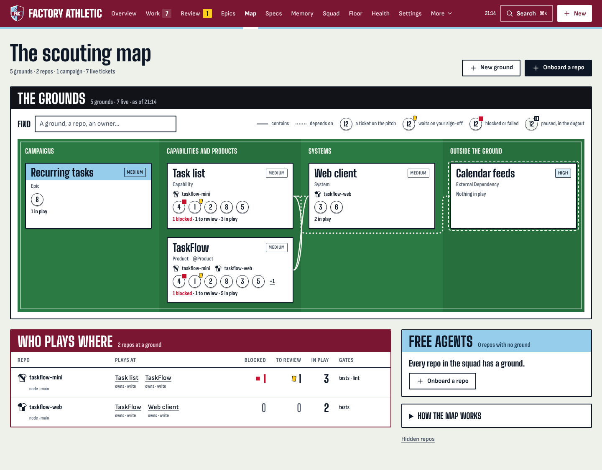
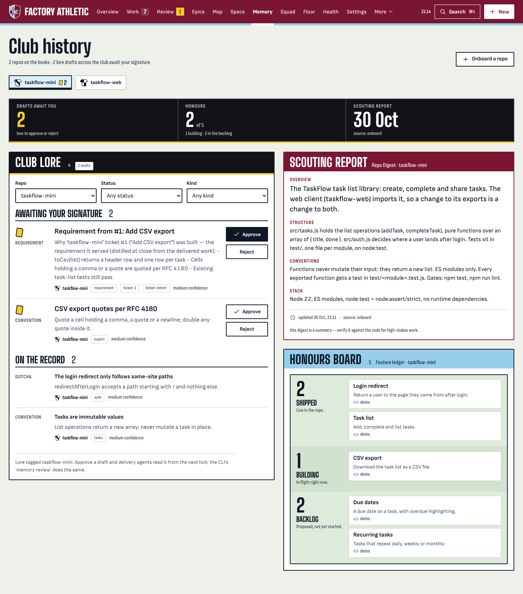
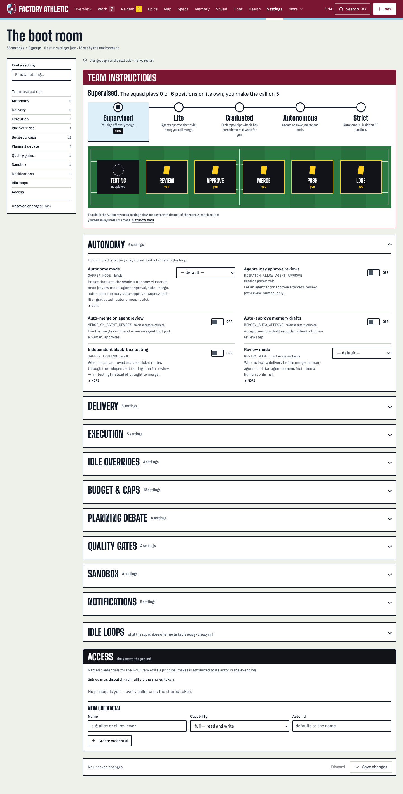

# Gaffer — feature tour

A longer walk through what the factory actually does, surface by surface. The
[README](../README.md) is the scannable version; this is the deep-dive.

> Every screenshot here uses a neutral **demo dataset** — a fake "TaskFlow"
> task-management product with two repos (`taskflow-mini`, the task-list
> library, and `taskflow-web`, its web client), a club named Factory Athletic and
> a squad of named agents. It is not anyone's real code, and it's seeded purely
> to show the surfaces with believable content. The ticket in review was
> delivered by a stand-in worker through a real runner tick, so its gates,
> checks and diff are real.

---

## The planning engine — brief → dependency-ordered epic

The headline feature. A one-line brief becomes a **phased, dependency-ordered
epic of tickets**, each ready to be worked through plan → implement → test →
review.

### How the decomposition works

The "Plan a build" panel runs a real, multi-turn decomposer (the dashboard's
`POST /plan-build` spawns `runner/bin/decompose.mjs`, a headless `claude -p`):

1. **Clarify.** The first turn usually comes back as a short list of
   **clarifying questions** — cadence, scope, whether to extend an existing
   service or stand up a new one. You answer in plain language; answered
   questions are treated as settled on later turns.
2. **Propose.** Once it has enough, it returns a **plan**: an epic plus an
   ordered list of tickets. Every ticket carries a title, a description,
   **acceptance criteria**, a target repo, a priority, and an explicit
   **`dependsOn`** edge naming the tickets it can't start before.
3. **Confirm.** The plan is *proposed only* — nothing is created until you press
   **"Create as draft"** or **"Create & ready"**. Drafts never sneak work into the
   queue; "Create & ready" readies only the tickets that pass the `ready` gate
   (a criterion-less ticket stays draft).
4. **What you agreed is checked.** Every answer you gave the planner is a
   requirement. The proposal lists them under *Agreed while planning* and flags
   any that no proposed ticket's criteria cover (a "30-minute expiry" with no
   criterion mentioning 30 minutes). Each one you keep becomes a criterion of the
   Final (the epic's acceptance ticket), so the independent tester checks it even
   when the planner's tickets left it out. `POST /epics` takes them as
   `epic.agreed_requirements`, or reads them from `plan_session_id`.

You are never trapped in the clarify loop: **"Build the tickets"** forces the
best plan from the brief and answers so far, and a long conversation
force-plans rather than dead-ending.

*The team talk on the Plan-a-build page: the brief "add recurring tasks", the
planner's three clarifying questions, your answer, and the proposed draw, the
**Recurring tasks** epic in four rounds plus the Final acceptance ticket.
Proposed tickets are numbered T1–T5 until you confirm, and T2 shows `after T1`.
Each carries its repo, priority and acceptance criteria. The guardrail banner is
explicit: proposes only, confirmed tickets land as draft.*

### From the terminal: `gaffer plan`

`runner/gaffer plan "<goal>"` is the same conversation without the dashboard. It
runs the same planner through dispatch's own plan-build runner (the
`runner/bin/decompose.mjs` helper, the same prompt, the same budget admission and
dollar cap), so a turn costs what a dashboard turn costs and is refused when a
dashboard turn would be.

- The planner's questions are printed. `gaffer plan --answer "…"` answers them and
  `gaffer plan --now` is "Build the tickets". At a terminal it asks you in place.
- The proposal is printed: the epic, each ticket with its repo, bootstrap flag,
  `after T1` edges and criteria, the Final the factory adds, and every answer you
  gave, flagged when no proposed criterion covers it.
- Nothing is created until you type y or run `gaffer plan --yes`, which creates
  the proposal you were shown (it never plans again). The create is the dashboard's
  confirm: a repo that doesn't exist yet rides on `source` for the bootstrap, the
  brief and the agreed answers ride on the epic, and the same `createEpic` makes
  draft tickets plus the Final. Nothing is readied.
- `--yes` runs on its own. With a goal, `--answer` or `--now` it is refused before
  any model call, so a plan is never made and created in one step you didn't see.
  A new answer drops the proposal it supersedes, so a failed turn after it leaves
  nothing to create, and the draft names the factory it was planned in (its data
  dir and dispatch database): a draft copied elsewhere, or `--yes` against another
  `DISPATCH_DB`, is refused. While the factory is paused on the usage window a
  turn isn't started (exit 75). It exits 0 when the epic is created and 4 while
  nothing is created yet (questions asked, a proposal waiting for `--yes`, or a no
  or Ctrl-D at the prompt).
- `--repo <name>` extends a registered repo (brownfield), `--file <path>` reads
  the brief from a file, `--show` prints the pending proposal, `--discard` drops
  it, and `--list` lists the epics. The conversation between runs is kept in
  `.gaffer/plan-draft.json`.

### Greenfield vs brownfield

The decomposer takes one of two shapes depending on whether you point it at an
existing repo:

| Mode | When | What the plan looks like |
|---|---|---|
| **Greenfield** | "New app", no target repo | Exactly **one bootstrap ticket** (`git init` + scaffold, no dependencies); every other ticket transitively depends on it. A one-liner becomes a brand-new, structured repo. |
| **Brownfield** | "Extend existing", a target repo/scope is chosen | **Zero bootstrap tickets** — there's nothing to scaffold. Every ticket is stamped with the target repo, so the plan *extends* what's already there. |

The TaskFlow example above is brownfield: "add recurring tasks" to the existing
`taskflow-mini` / `taskflow-web` repos — the data model first, then the API,
then the next-occurrence logic and the repeat picker in parallel, and finally
the docs.

### The epic as a first-class object

Once confirmed, the epic isn't just a label on a pile of tickets — it's the
dependency graph the board enforces. Tickets are **gated phase by phase**: a
phase can't start until the one before it is done.

*The Recurring tasks campaign on The season (`#/epics`), as four rounds and the
Final. Round 1 (the recurrence rule on the task model) unblocks Round 2 (the
API), which unblocks Round 3 (the next-occurrence logic and the repeat picker,
which run in parallel), which unblocks Round 4 (the docs); the Final acceptance
ticket waits on all of them. Each card shows the tickets it waits on until they
land, and the footer names the next fixture: #8, the only one ready.*

---

## The work board

Day-to-day, work lives on the board. Tickets flow through
**draft → ready → in-progress → blocked → review** lanes:

- **Draft** — being shaped; vague tickets park here for a human rather than
  being forced through. Acceptance criteria are added before a ticket can go
  ready.
- **Ready** — claimable; the runner picks these up. A ready ticket with no
  repo it may write to (the default `solo_loose` pack only warns about it) is
  parked as blocked (`no_write_repo`) rather than delivered or retried; one
  whose write repo has no local checkout is parked as `no_local_repo_path`.
- **In progress** — claimed by an agent (the card shows which one).
- **Blocked** — surfaced for a human, not silently retried forever. You can park
  a draft, refining, ready or by-hand ticket yourself with `gaffer wg block <n>
  --reason "…"` (recorded as you, `$USER`) and send any blocked ticket back with
  `gaffer wg unblock <n>`: to draft or refining when you blocked it from there,
  otherwise to ready (`--to` picks). An agent still blocks only its own claim,
  with its claim token. The runner's park reasons name the command.
- **In review** — delivered, awaiting your sign-off.

Every card carries a **risk badge**, a **priority**, and live
**acceptance-criteria progress** (`2/3 satisfied`).

**A ticket's contract can be fixed until it is claimed.** `gaffer wg ticket edit <n>`
changes the title, description, policy pack or priority, and `gaffer wg ac edit <n>
<ac>` / `gaffer wg ac rm <n> <ac>` correct or remove a criterion (`<ac>` is its
position, 1 for the first, or its id); REST has `PATCH /tickets/{id}` and `PATCH` /
`DELETE /tickets/{id}/acceptance-criteria/{acId}`. So every ready-gate refusal names
something you can fix: `DESCRIPTION_REQUIRED` with `ticket edit -d`,
`AC_VERIFICATION_REQUIRED` with `ac edit --verify`, `REVIEWER_REQUIRED` with
`ticket set-reviewer`, `HUMAN_APPROVAL_REQUIRED` with `ticket approve-ready`, and
`ticket create` warns when the pack will need a description it wasn't given. The
contract (title, description, policy, criteria, check commands) is editable in
draft, refining, ready and blocked. From claimed on it is frozen, because the
review and the tester are held to the contract the delivery saw: every contract
edit, `ac add` included and over MCP too, is refused with `CONTRACT_FROZEN` (409)
until the ticket comes back for rework. The test contract the independent tester
reads is held the same way once the tester has it: editable up to `in_review`,
`CONTRACT_FROZEN` from `in_testing` on. An edit to a ready ticket must keep it
passing its ready gate. Each edit is an event on the ticket (`ticket.edited`,
`ac.edited`, `ac.removed`), and an edited criterion goes back to pending.

The board stays usable on a factory with years of history. The Work view loads
a visible window of each lane (`GET /api/board?limit=200`; Done, failed and won't-do
newest first) and the lane heads show each lane's true size from the server's
`counts`; the rest of a lane is one link away in the List view, which filters on
the server. A filter typed on a windowed board applies to the loaded cards and says
so. Without `limit` the board answers the first 500 cards of each area (its `counts`
say how many there are, and `area` with `offset` pages one), and `GET /tickets`
answers 500 rows with a `next_offset`, so a bare read of a big board stays small (a
20k-ticket board used to answer 54 MB). The views that need every ticket's links (the
Map, the Overview, Epics, a ticket's campaign card) read them in batches through
`GET /tickets/details` (by `ids`, or a page of every ticket, with only the parts they
use) and every repo's grounds through `GET /scope/repos?all=1`, instead of one
`GET /tickets/:id` per ticket: the Map at 2,000 tickets settles in about 0.6 s with
14 requests (it took 2–4 s and over 600).

An acceptance criterion can be **machine-checkable**: give it a check command
(`npm test`, a script, an HTTP probe) and the runner executes it in the delivery
worktree after the Definition-of-Done gates. Exit 0 marks the criterion
satisfied as *runner-verified*, with the output stored as evidence; a failure
sends the delivery back to rework with that output as feedback — and the done
gate refuses a checked criterion an agent merely *claimed* to have met. The
repo page holds the Definition-of-Done gate commands (test / lint), auto-detected
at onboarding and editable there, because a wrong gate command is the commonest
reason a delivery bounces or ships unverified. The typecheck gate runs the repo's
package.json typecheck script (a `typecheck`-style script or a bare
`tsc --noEmit`), read from the base branch so a delivery cannot delete it away;
`GAFFER_DOD_TYPECHECK_CMD` overrides it. The same holds for every gate: when a
gate command calls a package.json script (`npm test`, `pnpm run lint`), the
script is read from the commit the delivery branched from, and a delivery that
rewrote it runs the base script instead, so editing `package.json` cannot
redirect its own gate. The repo's coverage command is stored on
the same page but is **not** a Definition-of-Done gate (coverage-did-not-decrease
needs a stored baseline and is deferred): it feeds the idle coverage scan below.

The board is **live**: the control plane streams its event log to the browser,
so a transition shows up within a second instead of on a polling timer.

**The club and the squad.** The header crest carries the club's short name and
its name from `/api/club`; with the full token it opens *Name your club* (name,
crest letters, the two kit colours, with a live preview), and the kit colours
re-dress the header, crest and shirts with a contrast guard. Every agent is shown
by its display name and shirt number (`/api/squad`, or the `agent_display` a
payload carries) on the board cards, the Tactics board, Review, ticket timelines,
Squad & form and Health. The **Squad** page (`#/squad`) lists the squad and
renames an agent in place; a taken shirt number is refused with the holder's
name, and a read-only token sees no editors.

**Read-only access.** A read-scoped token (Settings → Access, `wg principal
create <name> --read`, or `print-read-token` with the dashboard's `GAFFER_DATA`
for its own token's twin) sees one "Read-only access" strip and every control that would
change something switched off with a title saying why, on every view: Review's
sign-off, Revoke and Reopen, the Map, ground and repo editors, Onboard, Author a
spec and Freeze, and the whole Plan a build composer. The page never sends such a
token's write, so nothing comes back as a 403; the `s18-read-only` browser suite
walks 23 views to keep it so. The login gate sends no data call until a token is
there: `/healthz` says whether one is wanted, and a stored token is checked once.

**The Team sheet** lists everything waiting on you, one action a row: decisions,
sign-offs, approved changes to merge, blocked tickets, a delivery paused at a cap
(Continue… offers Continue and Stop) and one row for the lore drafts awaiting
approval (it opens Memory). *Delivered today* counts the tickets that landed
since midnight UTC and opens the Floor, whose lorry shows the same ones.

**The headline names the work.** The Overview's scoreboard headline leads with
the ticket's title, the number kept as a muted reference after it: "Webhook
delivery #10 is blocked by a failing test.", never "#10 is blocked." With nothing
blocked, the first thing waiting leads ("Export tasks to CSV #12 awaits your
sign-off."). The same goes for every scoreboard sentence that names a ticket (an
approved change not yet merged, the tickets the squad is on, Health's recurring
injuries, the Review page's "moved on" card). On a phone the count is said once,
on the Team sheet: the headline drops its "3 things need you." for the work, and
the scoreboard keeps the three counters not already on screen.

**The Floor.** `#/floor` draws the live factory as an isometric floor: stations
along a conveyor in lifecycle order (drawing office, Stores, Assembly,
Inspection, test rig, loading bay, Despatch), one parcel per open ticket at its
station, a robot in the agent's shirt number on every live claim, a hazard-taped
jam bay with a beacon for blocked, paused and failed tickets, a spend tank filled
to today's wage bill against the daily budget, and a lorry carrying what was
done today. It reads the Overview's own data and refreshes on the live stream.
Parcels, robots and stations are links with sentence labels; the stations and
benches are also listed as text under the drawing.

**Health: what the numbers mean.** `#/health` (and `GET /api/health`) reads the
usage ledger and the ticket transition log, and says only what those can show:

- **Rework.** A ticket is *sent back* when a reviewer or the tester rejects it,
  or when the runner retries it after a failed gate; both count. Every delivery
  ledger row carries its attempt (a hash of the claim plus the attempt number,
  never the claim token) and the time it started, so **spent on rework** is the
  delivery spend of the attempts that started after the ticket's first send-back.
  A $1 attempt, a rejection and a $3 correction read as $3 on rework (75% of
  spend), and the referee's **rework rate** as 1 of 1 merged tickets sent back.
  Each ticket's row says how many send-backs came from review and how many from
  the runner, and whether its spend was placed by attempt or, for rows older than
  attempt ids, by the call's end time minus its duration.
- **Flow efficiency** is the median share of a shipped ticket's lead time with
  an agent working on it (`claimed` or `in_progress`). Everything else is
  waiting, and the form guide lists it on its own: **waiting to merge** (approved,
  in `ready_for_merge`, with the longest wait), **in review or testing**, **sent
  back, waiting for rework** (back in draft, refining or ready after work began,
  waiting for a human to refine it or the runner to claim it again), **blocked or
  paused**, and **before work started** (everything before the first claim), plus
  the share of lead time queued after work began: review, the merge queue,
  send-backs and holds. Review counts as waiting because the transition log shows
  how long a ticket sat in review, not how long anyone actively reviewed it. A
  ticket that took 11 minutes to reach merge-ready and then waited a week reads
  under 1% with a week's merge wait, not 100%. A ticket sent back to refining
  that waited three days there shows those days as a send-back, not as time
  before work started. With nothing shipped the figure is a dash.

*Tickets spread across the lanes: the Recurring tasks drafts being shaped,
ready work waiting, two tickets claimed by Bez and Mo, one blocked after three
rework attempts, and the CSV export Kev delivered into review. On the pitch lists
which agent holds which ticket.*

---

## The human review gate

When an agent delivers, the ticket lands in **Review** — and this is the
structural barrier the whole design hangs on.

- The agent **cannot approve or merge its own work**. Approval is enforced
  server-side; an agent actor is refused unless you explicitly opt into agent
  approval (see [Settings](#control-you-opt-into)).
- The diff you review is the **real `git diff`**, computed server-side from the
  delivery branch against the repo's default branch — not a summary the agent
  wrote about itself.
- **The runner's facts come first.** Under the title, a **verdict strip** shows
  what the runner recorded, not what the agent says: each Definition-of-Done
  gate (passed, failed or skipped, with the command it ran) and the test count
  the runner saw in the test gate's own output (vitest, jest, pytest, cargo,
  `go test -v`, `node --test`); the independent tester's verdict and the commit
  it tested (or "after you" when it runs after your approval); cost and turns so
  far from the usage ledger; the attempt and who sent it back before; the risk
  level with its reasons (recorded, then the diff's own risk flags); and the
  reviewed-commit pin when one is recorded. The **acceptance-criteria table**
  shows each criterion's check command and the runner's recorded exit code, or
  **no machine evidence** on a yellow card when only the agent's word (or
  nothing) backs it. When the agent's evidence for the current attempt claims a
  count for the whole suite ("all 42 tests pass", "42/42", a pasted runner line,
  or a bare "42 tests pass" outside a criterion's evidence) or "all tests pass",
  and the runner's output contradicts it, a flag says so: "the summary says 42,
  the runner saw 40". A count for part of the suite ("3 new tests", "30 unit
  tests", one criterion's or one file's "3 tests pass", "1 of 2 passing") is not
  compared, nor is a claim from an attempt that was sent back. Gate results, the test count and criterion exit codes
  come only from rows the runner recorded as the system, and the tester's verdict
  only from the row a tester pass or fail recorded; an agent-recorded row that
  looks like a gate report or a tester verdict is ignored. On a reworked ticket
  the strip shows only this round's facts: a tester verdict or a review pin
  recorded before the ticket last entered review, and a criterion's check result
  from before the latest send-back, are about earlier code and are left out (the
  landing check ignores such a pin too). It is
  one read (`GET /tickets/:id/dossier?include=packet`), no model call. The count
  is what the test runner printed, and the tests run the delivered code, so treat
  a match as consistency, not proof. The runner keeps those summary lines with
  tabs turned into spaces and drops any that start with `GATE`, `---` or
  `gotest-tally:`, and it reads gate rows only outside the framed output blocks,
  so a test that prints a gate-shaped line cannot add a gate to the strip.
- The **Approve button stays disabled until that diff actually loads.** You
  can't sign off on a change you couldn't see; even the keyboard shortcut
  fails closed.
- **Your approval is bound to the commit you read.** The diff names the commit it
  shows for each repository, and Approve sends those commits back. If a branch moved
  between the diff loading and your click, the approval is **refused** (`409
  stale_revision`): nothing is approved, the Review view says the change moved and
  reloads the new diff. `wg review approve` takes `--commit <repo>=<sha>` (the values
  `wg ticket diff <n> --heads` prints; one per repository, and naming a repository twice
  is refused with 422 whatever the order), and `gaffer approve` shows the commits and asks
  before approving them; the factory's own agent review names the commit its reviewer
  judged and follows the same rule (a multi-repo ticket, whose other repositories the
  reviewer did not read, waits for you). The approval pins each repository's commit
  as the reviewed commit; every landing
  path (the Merge button, `gaffer merge`, the runner's merge lane) merges only
  that commit and **holds** a branch that moved past it ("moved since the review
  approved it") until it is re-reviewed. A tester PASS of a commit nobody
  reviewed holds the same way.
- **A ticket that spans several repositories is done when every one landed.** Each
  repository's approved commit is merged and recorded separately; the ticket only
  becomes *done* once all of them are on their default branches. Before the first merge
  every landing path checks every repository still to land: one whose branch moved since
  the review approved it, one with no approved commit, one whose checkout or delivery
  branch is missing, or one whose required CI is red refuses the **whole** ticket. Nothing
  is merged anywhere, the ticket stays in *Ready for merge*, and `gaffer merge` exits 4
  naming the repository and the commands that fix it (for a moved branch:
  `gaffer wg ticket reopen-for-review <n> --as admin --reason "..." --resolution "..."`,
  then `gaffer approve <n>`). If one lands and another cannot for a reason only the
  landing itself finds (a conflict or a dirty checkout), the ticket stays in *Ready for
  merge* and shows as **Partly merged** in what needs you, naming which repositories
  landed; a red merge gate holds it for you instead (blocked, the landed repositories
  still recorded). The next merge lands only the rest. A partly landed ticket can only
  be finished: `wg wont-do` and a cancelling send-back are refused with `PARTLY_LANDED`
  (every landing on record counts, so a send-back or a reopen first changes nothing), and
  a send-back to rework is held for you (blocked, parked as `partly_landed`) instead of
  going back to the queue as if nothing had merged. A landing (`wg ticket record-landing`, which every
  landing path calls per repository) is recorded only when it can be shown:
  `--via local` needs the approved commit in the default branch's history; `--via pr`
  needs a pull request on record for that repository and the change in the local default
  branch (its history, or, after a squash or rebase merge, merging the commit into it
  changes nothing); `--via pr-stale` needs the PR and checks the remote-tracking copy of
  the default branch (or, without one, the local default branch). So *done* means landed
  (`wg ticket landing <n>` shows the state; once the
  approval is withdrawn by a send-back, a won't-do or a reopen it shows no approved
  commit, the same as the ticket's status). The
  runner's merge lane (and so **Poll for work**) finishes it only under the same
  policy that lets it land any approval, decided again at that moment: a human
  approval with Auto-merge on, or an earned merge grant. Turn Auto-merge off, or
  withdraw an agent approval's `MERGE_ON_AGENT_REVIEW`, and the ticket stays
  *Approved · partly landed* (its status says nothing lands the rest on its own)
  until someone presses **Merge now**. An approval covers
  **every** write repository: while one's delivery head cannot be read (no checkout
  here, an unreadable path, its delivery branch missing) the approval is refused
  (`repo_unavailable`) and the button reads *Approve held: <repo> unavailable*,
  with what to do: attach the checkout or restore the branch, or make the
  repository read-only on the ticket (a read-only repository never blocks). The
  runner's agent reviewer reads only the primary repository, so its approval of a
  multi-repo ticket is refused: a note on the ticket says so, the ticket waits for
  a person, and the same delivery head is not reviewed again.
- **Approve does not merge unless you ask it to.** With `AUTO_MERGE` off (the
  default) an approved ticket waits in *Ready for merge* for **Merge now**; with
  it on, a human approval lands on its own (an agent's approval also needs
  `MERGE_ON_AGENT_REVIEW`, or an earned per-repo grant).
- **The button says what the click does.** The server works out the first step
  an approval will certainly take from the settings and ticket state the approve
  path itself reads, and the sign-off button names it: **Approve and send to
  tester** (the testing lane, or an epic's acceptance ticket), **Approve and land
  now** (Auto-merge on with a merge command: the landing check and the merge gate
  run at once, through the PR in PR mode), **Approve, lands on next tick**
  (Auto-merge on, or an earned merge grant, with the runner's merge lane doing
  the landing), **Approve, merge is a separate click** (Auto-merge off: it waits in Ready for merge for Merge now), **Approve
  held: CI not passed** (required CI has no PASS for the commit, so the server
  would refuse), or **Approve held: <repo> unavailable** (a write repository's
  delivery head cannot be read, so the server refuses an approval that could not
  cover it). When the delivery changed the tests that gate it, an agent's or
  auto approval is held (*Approve held: tests changed, a person must allow it*)
  but a human's is not: the line under the button says so and points at the
  test-changes banner. A line under the button says what follows; on a multi-repo
  ticket it says every write repo lands the same way, one merge each through the
  merge gate, and that a repo that fails is held while the landed ones stay
  recorded; under Review mode *both* the line says this click is the human
  confirmation. The armed button only says it lands
  when it does ("Confirm and land now"); after approval the button and the band
  under it say where the change went (`GET /tickets/:id/diff` carries
  `approve_outcome`).
- **An approved ticket's status says where its landing is.** It never reads
  "merging" unless something merges it: *Approved · waiting for Merge now*
  (Auto-merge off, or nothing else lands it), *Approved · lands next tick* (the
  runner's merge lane lands it: Auto-merge on and a human approval, or an earned
  merge grant; *(paused: usage limit)* with the time while the usage window has
  paused the runner), *Approved · landing* (a merge the dashboard started is running;
  a second **Merge now** meanwhile is refused with `MERGE_IN_FLIGHT` and starts nothing,
  and `gaffer merge` beside it exits 4),
  *Approved · partly landed* (a landing is recorded for some of its write repos'
  approved commits, not all: Merge now lands the rest and never re-merges a
  landed one), or the hold's own words — *Held · moved since review* (naming the
  repo whose branch moved off its review pin), *Held · approval does not cover
  every repository* (a write repo with no approved commit), *Held · merge gate
  failed*, *Held · CI red*.
  The server stamps it as `landing_state` on the ticket, the board cards, the
  ticket list and the Team sheet. The ticket page's *Your move* says the same
  thing in its own words and offers the action that clears it (**Back to review**
  for a branch that moved since review or an approval that missed a repository;
  the `ticket.reopened_for_review` event records that cause, and only the conflict
  resolver's reopen says a merge conflict was resolved), and the page follows the
  live stream: when a landing completes, every open tab of that ticket turns to
  Done and drops its merge actions without a reload. Text typed in a field on the
  page and not yet sent keeps the page as it is until it is sent or cleared.
- **A request for a human is never "Nothing flagged".** The runner's
  `needs_human_review` notes, a reviewer agent's CHANGES, a tester's FAIL or hold,
  a merge-gate hold, a flagged DoD gate and an observed-risk escalation are read
  from the same evidence rows the Evidence list shows. They head the flags, count
  in the summary line, sit in a yellow band beside the button (a live status for
  screen readers), and the evidence row they came from is marked *asks for a
  human*. With the verdict strip on the page they read its gate rows, so the
  sign-off never says a gate failed under a strip that says the gates passed; a
  test change is one *Test modified* flag beside the test-changes banner, never
  repeated as an integrity gate or a risk level.
- **"Done" means the combined code passed the gates on the target.** A branch
  that passed its gates and a default branch that passed its gates can still
  merge cleanly into something that fails (one side renames the field the other
  side starts reading). So before anything lands — the merge lane, **Merge now**,
  `gaffer merge`, the agent review's ship — the factory builds the merge of the
  approved commit onto the *current* default branch in a scratch worktree and
  runs the repo's Definition-of-Done gates on **that** merge — the same gates the
  delivery ran: its test and lint commands and the typecheck script detected from
  its package.json (read from the default branch first). It lands exactly
  the gated merge commit, and only while the default branch is still the commit
  it gated (compare-and-land; a branch that moved meanwhile is gated again). A
  red combination never lands: the default branch is untouched and the ticket
  waits in your queue (*blocked*, `merge_gate_red`) with the failing gate output
  as evidence. In PR mode the gate runs on the merge onto the freshly fetched
  remote default branch before `gh pr merge` is asked; GitHub's branch
  protection ("require branches to be up to date" plus required checks) is the
  compare-and-land upstream.
- **A cancellation or a red check during the merge gate stops the landing.** The
  gates can take minutes, and you can cancel the ticket or a required check can
  turn red while they run. After the gates pass and immediately before a default
  branch moves (or the provider is asked to merge a PR), every landing path asks
  Dispatch again, once per repository: is the ticket still *Ready for merge*, on
  the same approval, with that repository's approved commit and green required
  CI? That check and a record that the landing has started are one transaction.
  If the answer is no, nothing lands, the merge says `not landed: <reason>` and
  exits non-zero, and the ticket stays as you left it (*cancelled*, or *blocked*
  for the red check). If a landing had already started, the cancellation or the
  failed check says so on the spot (`landed_already` in its output and a
  warning naming the repository and commit): it stops every landing that had not
  started and cannot undo one that had. The won't-do button and a board move
  back to rework report it the same way. That landing still goes on record, and
  the merge then says `LANDED AFTER A REVOCATION` and exits 4 instead of
  reporting a clean merge; the ticket stays cancelled or blocked, not done. Once
  a repository's landing is on record, or git already shows a started landing
  on its default branch, a cancellation is refused outright and names it; land
  the rest or revert it first.
- **Every recorded pull request lands upstream.** A repository whose delivery
  record carries a PR lands only through that PR, secondary repositories
  included: the merge gate runs on its freshly fetched remote default, then the
  provider is asked to merge that PR. A merge into the local checkout is not a
  landing for such a repository, so the ticket is done only when every recorded
  PR has merged. If the provider refuses one, that repository does not land and
  the ticket stays open (*partly landed*). `GAFFER_PR_LOCAL_FALLBACK=1` is still
  the explicit way to land a PR repository locally instead, for each one.
- **The independent tester's assertions run on what lands, not only on what it
  tested.** The tester's PASS is about the commit it tested, and its black-box
  tests live on their own branch (`gaffer-tests/ticket-<n>`), never on the
  delivery branch. After the default branch moved, the merge could pass the
  repo's own suite yet fail the tester's saved assertion. So once the merge gate
  passes, the same scratch merge also gets the tester's test files (only the ones
  it added or changed, never its agent wiring) and the repo's test command runs
  there too — on every landing path, PR mode's gate on the fetched remote
  included. The tester's files run **by path** with the stack's runner
  (`node --test <files>`, vitest/jest by path, pytest, `go test` on their
  packages, `cargo test --test`) where that is well defined, else through the
  registered command, and each file must show the runner's own evidence that it
  ran: a repo whose registered command runs only some files can no longer report
  a tester file as passed that never executed. For node:test that evidence is a
  line the runner's reporter signs with a per-replay key the test processes never
  see, so a delivery that stops the tester's file and prints "passed" for it
  proves nothing; a run that reports a file it was not given, or a vitest/jest
  report that names other files or miscounts, proves nothing either, and plain
  output text never counts. A file with no such evidence
  holds the landing (*blocked*, `tester_replay_unverified`, naming the files,
  in `gaffer status` too) and nothing is recorded. A failing assertion holds
  the landing exactly like a red gate
  (*blocked*, `tester_replay_red`, naming the files, the output as evidence,
  the default branch untouched); the tester's files run on the candidate but
  never land. When the candidate lands, the runner records **which tester
  assertions passed on which landed revision** (`gaffer-tester-replayed:<sha>`,
  a system record only the landing path writes). That record is the one answer
  everywhere: the ticket page's *On the landed revision* list, `gaffer status`,
  and `wg stats`, which counts an epic as **accepted** only when its acceptance
  ticket has it (*unreplayed* otherwise). A held replay keeps the epic out; a
  repaired, re-tested retry that lands counts it once. A ticket the tester never
  saw runs nothing extra. If a merge is interrupted after it landed but before it
  wrote that record, the next `gaffer merge` (or the merge lane) replays the
  tester's files on the revision that landed and writes it; when that cannot run,
  the ticket stays *Ready for merge* with `replay missing: … run gaffer merge <n>`.
- **An epic is accepted on its current scope, once.** A ticket you add to an epic
  after planning (a primary or secondary scope link) makes the epic's acceptance
  ticket wait for it, like the planned ones. If the acceptance ticket finishes
  while a member is still open, the epic reads *pending*, and *stale* when a
  member lands after it (`wg stats --json` marks these `scope_incomplete` and
  `scope_changed`). Taking a ticket out of the epic (removing the link, or
  marking it rejected) takes that wait away again; a dependency you added by
  hand stays. A follow-up that itself waits on the acceptance ticket can still
  be linked: it cannot also be waited on, so the epic reads *pending* until it
  is done. A suggested or rejected scope link counts for nothing:
  each epic is counted against its own acceptance ticket only, so linking one
  epic's finished acceptance ticket to another epic never makes that epic
  accepted.
- **Required CI is required.** With *Require CI green before review* on, the
  runner records the CI result for the exact commit under review (a result is recorded
  only for one of the ticket's own commits: a delivery head, a recorded delivery commit
  or an approved revision; `wg ticket ci-result` refuses any other); approval (and
  a tester PASS) is refused until that commit's CI has passed, a red result for an
  approved ticket holds it for you (*blocked*, `ci_red`), and the merge lane reads
  CI again before landing. The CI gate asks `gh` only for the fields the real CLI
  exposes (`gh pr checks --json name,state,bucket,link`).
- **A merge conflict is never force-resolved.** The resolver agent merges the
  default branch into the delivery branch, and the runner **re-gates the
  resolution** — no conflict markers, and the repo's Definition-of-Done gates
  (tests · typecheck · lint) green on a clean checkout of the committed
  resolution (what would land; anything the resolver left uncommitted is
  discarded, never gated), recorded as fresh evidence — before the ticket goes
  back to review. A resolution that fails is
  moved off the branch (`refs/gaffer/conflict-resolved/<n>`) and held for a
  human.
- **A delivery that changed its own tests is flagged, and never auto-approved.**
  The gates' **integrity** row compares the delivery with its base and FLAGs a
  deleted or renamed test file, a new skip/focus marker (`.skip`, `.only`,
  `xit`, `it.todo`, `it.concurrent.skip`, node:test's `{ skip: true }`,
  `t.skip()`/`this.skip()`, `@pytest.mark.skip`/`xfail`, `t.Skip`, `#[ignore]`,
  `@Disabled`, …), a changed gate script (or an added `pretest`/`posttest`, or a
  changed script it runs), a touched or newly added test-runner config, a test
  file hidden from git (skip-worktree / assume-unchanged), a test file that lost
  test cases or all its assertions ("test cases removed: 3 → 0"), or a package-manager rc
  file (`.npmrc`, `.yarnrc`, `.yarnrc.yml`, `bunfig.toml`) the delivery added or
  changed, which can make `npm test` run nothing (an ignored one on disk too; the
  runner's FLAG holds the approve even when the committed diff is clean). It compares against
  the commit the runner recorded when it cut the branch (kept across retries,
  never replaced by a later branch tip), so moving the base branch from the
  worktree, or a second attempt building on the first, cannot hide a change. The
  server recomputes the same check from the real diff (risk flag *Test
  modified*), the sign-off shows a banner naming each change, the Team sheet
  row carries a *Tests changed* chip, and an agent approve is held for a person
  whatever the ticket's declared risk. When the ticket really should change its
  tests, **Allow test changes…** on the sign-off (or
  `gaffer wg ticket allow-test-changes <n> --reason …`) records your allowance
  as an event: the row then reads PASS with a note. Only a person can set it.
  It does not change what the gate runs: a changed gate script still runs as
  the base has it, so to change the gate itself, change the repo's registered
  test/lint command or merge the script change first.
  The merge gate and the conflict re-gate run the same check on the merged
  tree, against the target head (scripts read from it, an integrity row in
  their checklist). This first slice flags; it never fails a delivery or a
  landing.
- **Reject** loops the ticket back for rework (or abandons it), with your reason
  recorded and its acceptance criteria reset. A **won't-do** on delivered work
  keeps its branch as a record, and that branch no longer counts against the
  repo's open-branch cap, so abandoning work never starves the queue.
- The **reviewer is never the author**, even when agent approval is allowed: the
  server refuses an approval from the agent that delivered the ticket, and the
  factory's own review pass approves as a distinct, registered reviewer agent (a bare reviewer string is refused).
- The **event log is tamper-evident.** Every event is chained by a SHA-256 hash,
  so a row rewritten, deleted or re-ordered after the fact breaks every hash
  after it; `dispatch events verify`, `dispatch doctor` and the Health view's
  "Event log" card re-derive the chain. Each event also carries the **runner
  tick** that wrote it (the ticket timeline shows a `tick …` chip), so one tick's
  whole trail — the runner's calls and the agent's MCP writes — reads as one.
- **A flaky test does not burn an attempt.** With a worker pool
  (`GAFFER_CONCURRENCY` above 1) a red tests gate is rerun once at concurrency 1
  (one rerun at a time across the pool, after the other workers' gate runs finish)
  before the attempt counts. Only the tests gate, only once. A pass on the rerun is
  a green gate marked **Flaky suspected** on the Review card, its note naming both
  runs, with the first run's output kept in the DoD evidence and a
  `needs_human_review` note on the ticket; a second red is the failure, naming both
  exit codes. `GAFFER_DOD_FLAKY_RERUN=0` turns it off.
- **The merge commit says where it came from.** Every landing path (the Merge
  button, `gaffer merge`, the merge lane, the AFK review pass, a PR merge) writes git
  trailers into the merge commit, read from the dispatch DB:
  `Gaffer-Ticket: #12`, `Gaffer-Reviewed-By: human:tom` (or `agent:<id>`) and
  `Gaffer-Gates: DoD PASS (tests pass, lint skip); AC 3/3 satisfied; tester PASS`.
  The tester part comes from the tester's own verdict transition since the latest
  approval, never from evidence an agent could record.
  The merge gate's gated merge commit, which is the commit that lands, carries
  them, and it is then `--no-ff`, so there is a merge commit to carry them. No
  model name is written (the usage ledger records that), and the trailers are not
  signed. `GAFFER_PROVENANCE_TRAILERS=0` turns them off.
- **Every attempt names its model and its CLI.** The runner records, per delivery
  attempt, the model that served the call (and the one it asked for) and the
  Claude Code CLI version that ran it — on the usage-ledger row (`attempt`,
  `model_requested`, `claude_version`) and as agent-run evidence on the ticket. The
  ticket page's **Attempts** history shows "Model … · CLI …" on each attempt: a
  failure names the run of the attempt that failed (none when the agent never ran,
  as when its environment could not be installed) and carries that attempt's number,
  every other run (the attempt that passed after a failure) follows the failures on
  its own row, and only the runner's own rows count, so an agent cannot name its own
  model. The attempt that used up the cap is on the history as a failure too
  ("Attempt 3/3 · definition-of-done failed"), recorded before the ticket parks.

*An in-review ticket on The gaffer's sign-off: no flags, the Definition-of-Done
gates (tests and lint passed), 3 of 3 acceptance criteria satisfied by the
runner's own checks, the evidence trail, and the server-computed diff for
`taskflow-mini` — the new `toCsv` export and its tests. Approve / send-back are
the human's alone.*

---

## The Factory Map

Real products are several repos, not one. The **Factory Map** models that:
**scope nodes** group repos into products, systems and capabilities, and each
repo is linked into a node with a **relation** and a **default access** level —
`write`, `read`, `test`, or `none`.

Scoping a ticket to a node turns the node's repos into **suggestions** on the
ticket (ranked by relation, with the node's default access). A human confirms
which ones the ticket gets, one click per repo on the ticket panel; until at
least one is confirmed at `write`, `ready` refuses the ticket
(`SCOPE_REPO_UNCONFIRMED`) rather than queueing work the runner cannot deliver.
Once confirmed, the access is a boundary the runner enforces, not a suggestion:
the agent can write only to the `write` repos and read the `read` ones. Repos
with no mapping behave as standalone single-repo scopes, so nothing has to be
mapped to start working.

*The scouting map (`#/map`): the TaskFlow product node owns both repos with
`write` access and contains the Task list capability and the Web client system;
`depends_on` lines run from the web client to the task list and from the task
list to the Calendar feeds external dependency. Who plays where lists each
repo's relation and access at every node it belongs to.*

---

## Durable repo memory — the Repo Understanding engine

Gaffer doesn't re-learn a repo from cold on every run. **Memory** is the durable,
human-gated knowledge the factory works from:

- **Repo Digest** — a living TLDR of each repo's **overview / structure /
  conventions / stack**, seeded at onboarding and refreshed deterministically as
  tickets merge. It carries a freshness stamp and an honest caveat: it's a map
  to *verify against the code* for high-stakes work, never a substitute for it.
- **Feature ledger** — what's `backlog → building → shipped` per repo, so the
  factory knows what already exists before it proposes building it again.
- **File cards** — one per source file (path, symbols, content hash, a short
  summary), used to choose what to read before a ticket. After every merge they
  are brought in line with the merged commit, renames included, and each card's
  path and content hash is checked against that commit before memory records the
  repo as indexed there.
- **Lore** — the team's recorded conventions, decisions, gotchas, and cross-repo
  boundaries. It's **read-only in the product**: agents *draft* lore through an
  MCP review gate, and a human approves it in the Memory view or from the
  terminal (`gaffer lore review` lists the drafts the Memory view lists,
  `gaffer lore show <id>` prints one, `gaffer lore approve <id>` and
  `gaffer lore reject <id> --reason "…"` decide; `gaffer lore review --json`
  prints the page the Memory view reads). An agent shell can't run these, or the
  memory CLI's `approve` / `reject` / `review` / `add` and the verbs that change
  ratified lore: the safety hook denies them. It is never
  silently rewritten. Every edit snapshots the previous version
  (`memory history <id>`), so a change is diffable and reversible.

*Club history (`#/memory`) for `taskflow-mini`: the Repo Digest (the scouting
report) with overview, structure, conventions and stack, its freshness line and
the "verify against the code" caveat; the feature ledger (the honours board) as
shipped, building and backlog; and the lore, two drafts awaiting a human
signature above the approved records.*

Memory is also usable standalone — see
[`packages/memory/README.md`](../packages/memory/README.md).

**Backing up the board.** `gaffer wg export --out board.json` writes the whole
board (tickets, epics, scope graph, criteria, repos, decisions, reviews and
evidence, the event log, claims, planner sessions, paused deliveries) as one JSON
bundle; `gaffer wg import` restores it into an empty database, and `import --force`
replaces every one of those tables. What the export guarantees:

- **One consistent snapshot.** Every table is read inside a single SQLite read
  transaction, so an export taken while the runner, the API or another process is
  writing holds the board exactly as it stood at one instant: never a dependency or
  criterion whose ticket is missing. Writers are not blocked while it runs.
- **Proven restorable before it reports success.** The export restores its own
  bundle into a scratch in-memory database with the importer's checks (format and
  schema version, event-log hash chain, foreign keys, every row landed) before it
  writes the file or prints anything. If that fails it exits non-zero, writes
  nothing and says why, while you still have the source database to copy from.

Run-activity rows, API credentials and schema metadata are machine-local and are not
exported; the export's summary names them (`not_exported`).

---

## Control you opt into

Gaffer is **supervised by default**. A human readies tickets, a human approves
merges, and memory drafts wait for review. **Settings** is where you decide how
much of that to hand over — and every autonomy flag is **off until you turn it
on**:

| Flag | Effect when on |
|---|---|
| `DISPATCH_ALLOW_AGENT_APPROVE` | An agent actor may approve a ticket's review (otherwise human-only). |
| `AUTO_MERGE` | Land a human-approved ticket on the default branch without a second click (off: it waits for Merge now). |
| `MERGE_ON_AGENT_REVIEW` | Extend `AUTO_MERGE` to approvals made on an agent reviewer's verdict. Needs `AUTO_MERGE` too — alone it merges nothing (the run says so). |
| `REVIEW_MODE=both` | The agent screens first (a CHANGES verdict can bounce the delivery to rework) but a human still confirms every approval. |
| `MEMORY_AUTO_APPROVE` | Let the memory the runner itself files (the requirement distilled from each delivered ticket, onboarding induction lore, CLI `memory suggest`) go live without a human review step. Lore a delivery agent suggests over MCP always stays a draft, and a draft is invisible to other agents (search, duplicate hints, fetch by id) until you approve it. |

**A dollar cap before the first live run.** A live run (`gaffer run`, `loop.sh`,
the Work view's **Poll for work**) refuses to start until `GAFFER_DAILY_BUDGET_USD`
or `GAFFER_BUDGET_USD` is set, and says how to set one. In the dashboard the first
Poll asks for a daily budget, prefilled at $5, saves it under **Budget & caps** and
then polls. Every other paid launch (onboarding analysis, Plan a build, Suggest work,
the spec author, the merge resolver, the tester) is refused the same way; an onboard
without a cap writes the mechanical digest and cards and says why. Dry runs are never
refused; `GAFFER_ALLOW_UNCAPPED=1` in the environment opts out (a value in
`settings.json` is ignored). With no cap, `POST /poll-work`
answers `polled: false`, `reason: no_budget_cap` with the runner's fix and starts
nothing; a poll the runner refuses once it has started (a cap already reached) is
recorded as a `failed` run whose detail is the runner's reason, never `succeeded`.

The same panel controls the **idle loops** (background work the factory mines
between real tickets) and the **planning-debate** depth. Secret-bearing settings —
the Slack and generic webhook URLs, which are posting authority on their own — are
never shown back: the panel says whether one is set and names its host, with
**Replace** and **Remove**; only an admin principal can read the value through the
API. The **budget caps** (daily and lifetime, in dollars) are checked immediately
before every paid agent launch — a delivery, a review, Plan a build, Suggest work,
the tester, onboarding analysis, the merge resolver, the repo classifier that
links a new app to its sibling tickets — so an exhausted budget starts
nothing, wherever the work was asked for. A value that does not fit its setting
(a dollar cap that is not a number of 0 or more, Concurrent ticks below 1) is not
saved: the panel marks the field and says which one holds Save back, and the API
refuses the whole write with a 422 that names it. Every knob the factory
reads — its default, whether the panel can edit it, which component consumes it
— is listed in the generated [`CONFIG.md`](CONFIG.md).

**Maintenance when idle.** With the queue empty, an idle tick can run one scan
lane (security hotspots, coverage, test quality, type quality, tech debt,
documentation, dependencies) chosen by a deterministic priority-and-rotation
scheduler, no model in the choice. Each finding becomes a draft ticket that
carries a behaviour-preserving acceptance criterion with the repo's own test
command as its check, so the runner verifies the fix mechanically. The coverage
lane files a draft only when the coverage command succeeds and reports a total
**below** the `minimum_gap_threshold` target (a percentage); a repo at or above
it, a run that exits non-zero, or a report with no recognisable total
(coverage.py `TOTAL`, istanbul `All files`, Node's built-in `# all files`
report) files nothing. The same tick ingests labelled GitHub/Jira issues and
runs the lore-gap loop when it is on; the feature backlog runs just before the
lane, on its own switch. The scans cost nothing, so a tick that finds nothing
new is an empty poll (it drains the run and stays off the day cap); only the
feature backlog spends a model call, and it stops claiming a feature whose plan
failed twice in a row (`max_plan_failures`). The **Idle loops** panel holds the master
switch, the lane toggles, a recommended set, the dependency lane's audit
command, and the **self-improve** gate: opted-in repos, a risk ceiling and a
per-tick cap under which the tick promotes its own drafts to ready so the
delivery loop fixes them without a human in the promote step. Off by default;
the panel's status line says what the next idle tick will do — one lane per
tick, rotating — reading the runner's `GAFFER_MAINTENANCE`, `GAFFER_IDLE_MODE`
and `IDLE_DRAFT_WHEN_IDLE` overrides and each lane's prerequisites (the
coverage lane needs a repo coverage command and files only below its target).
Repos onboarded from the dashboard are scanned without editing `crew.yaml`.

**Feature backlog when idle.** With the **Feature backlog** toggle on, an idle tick
(before the maintenance lane) takes one `backlog` feature from the memory feature
ledger, moves it to `building`, plans it with one model call and files the epic as
draft tickets on that feature's repo, behind the usual human gate. A plan that fails
hands the feature back to `backlog`; after two failed plans in a row it is left there
for you. Off by default.
Confirming a brownfield epic yourself (every ticket on one existing repo) moves that
feature to `building` too.

**Usage limits pause the factory, they do not fail tickets.** When the model
refuses a delivery call because the plan's usage window ran out or a rate limit
hit, the ticket goes back to Ready without counting an attempt (any work the agent
had committed stays on its branch) and the factory pauses until the window resets:
the reset time Claude Code printed plus a minute (a 5-hour, weekly or per-model
limit alike, in both the older and the current CLI wording), or the **Usage-limit pause**
setting (`GAFFER_USAGE_PAUSE_DEFAULT_MIN`, default 60 minutes, never below 10) when
it printed none. No tick claims work meanwhile; `gaffer run --daemon`, the loop and
a worker pool sleep instead of spinning. `gaffer status` and the **Health** view
show "Paused until <time>: usage limit", and the ticket's timeline records the
refusal. The pause lifts on its own. An overnight run that hits its window no longer
parks good tickets. The same holds when the refused call was a new repo's
scaffold, the independent tester or the agent reviewer: the factory pauses and the
ticket waits where it was, rather than being parked or held for a person. A spend
cap or an admin switch is not a pause: it needs someone to raise the cap, so those
tickets are parked for a person as before.

Enabling autonomy **requires containment**: any agent ship or mutate flag turns
on the OS sandbox requirement, and a required-but-unavailable sandbox refuses to
launch the agent rather than run it uncontained. The provider is auto-detected
(`sandbox-exec` on macOS, `docker` where a Docker CLI exists).

*The boot room (`#/settings`): the Team instructions dial on Supervised and the
Autonomy flags, all opt-in and shown off, with Planning debate, Idle loops and
the other groups folded below. Nothing here is enabled by default — full
hands-off autonomy is a deliberate choice you make, not the starting state.*

---

## Skills — the right pack, mounted where the agent reads it

Every agent run (delivery, review, the independent tester, intake, planning, merge)
gets its own skill set from the factory library, chosen by role and by the ticket's
stack: the conventions pack of the language, the lenses of the role, and the packs the
ticket text calls for, never the whole library.

- **Every repo on the ticket counts.** A ticket spanning a TypeScript frontend and a
  Java service is selected for both stacks, for delivery, review and the tester alike,
  and each prompt names each repo's pack. Files named in the ticket (or, for review,
  the delivery's diff) still narrow the set to the ecosystems they touch.
- **Mounted where Claude Code looks.** Skills are copied to
  `.claude/skills/<name>/SKILL.md` in the agent's worktree, beside a repo's own skills;
  a repo skill of the same name wins, the prompt says so, and teardown removes only
  Gaffer's copies. The copies sit inside the worktree, so the safety hook lets the
  agent read them without any exception to its read boundary.
- **Use is measured honestly.** The Health view's skill panel shows, per skill, how
  often it was selected, applied (named in the agent's output), opened (a read the
  safety hook allowed) and refused (a read it blocked). A refused read never counts
  as use, and an open is never counted as an application.
- **A live check, on demand.** `GAFFER_LIVE_SKILL_TEST=1 bash runner/test/live-skill-use.test.sh`
  plants a harmless instruction ("include the token `GAFFER-SKILL-<role>-<nonce>`")
  inside each role's intended skill only, runs the real Claude Code CLI through the
  real tick on a tiny fixture repo, and checks each role's recorded result for its
  token and its telemetry row. It skips cleanly, saying what it needs, without the
  variable, a working CLI or credentials. Set `GAFFER_LIVE_SKILL_MODEL` to your
  cheapest model; it prints the cost.

---

## Where to go next

- [`../README.md`](../README.md) — the overview, architecture, install and safety
  model.
- [`../quickstart.md`](../quickstart.md) — a guided first run.
- [`../SECURITY.md`](../SECURITY.md) — the full threat model and honest residual
  limits.
- [`../runner/README.md`](../runner/README.md) — the runner runbook.
