# Gaffer feature tour

A longer walk through what the factory does, surface by surface. The
[README](../README.md) is the short version; [SECURITY.md](../SECURITY.md) has how each
gate is enforced and what it does not cover.

> Every screenshot uses a neutral demo dataset: a fake "TaskFlow" task-management
> product with two repos (`taskflow-mini`, the task-list library, and `taskflow-web`,
> its web client), a club named Factory Athletic and a squad of named agents. The
> ticket in review was delivered by a stand-in worker through a real runner tick, so
> its gates, checks and diff are real.

## The planning engine: brief to dependency-ordered epic

A one-line brief becomes a phased, dependency-ordered epic of tickets, each ready to
be worked through plan, implement, test and review.

### How the decomposition works

The Plan a build panel runs a multi-turn planner (`POST /plan-build` spawns
`runner/bin/decompose.mjs`):

1. **Clarify.** The first turn usually comes back with a few clarifying questions
   (cadence, scope, whether to extend an existing service). Answered questions are
   settled on later turns.
2. **Propose.** It returns an epic and an ordered list of tickets, each with a title,
   description, acceptance criteria, target repo, priority and the tickets it depends
   on.
3. **Confirm.** Nothing is created until you press **Create as draft** or **Create &
   ready**; the second readies only the tickets that pass the ready gate.
4. **What you agreed is checked.** Every answer you gave is a requirement. The
   proposal lists them under *Agreed while planning* and flags any no criterion
   covers; each one you keep becomes a criterion of the Final (the epic's acceptance
   ticket), so the independent tester checks it even when the tickets left it out.

**Build the tickets** forces the best plan from what you have said so far, so you are
never stuck in the clarify loop.

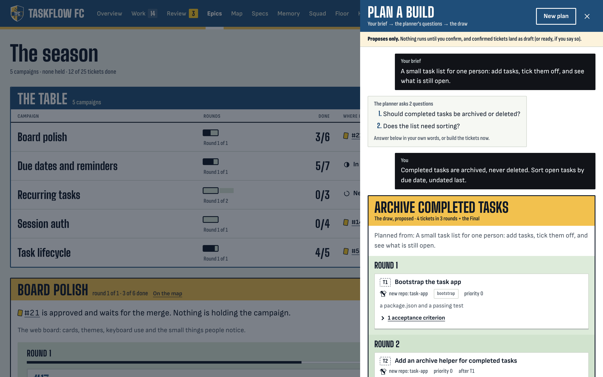

*Plan a build from The season: your brief, the planner's questions and your answer,
then the proposed draw, numbered T1, T2 and so on until you confirm. Nothing is
created until **Create as draft** or **Create & ready**.*

### From the terminal: `gaffer plan`

`runner/gaffer plan "<goal>"` is the same conversation without the dashboard, through
the same planner, budget admission and dollar cap.

- The planner's questions are printed; `--answer "..."` answers them and `--now` is
  Build the tickets. At a terminal it asks you in place.
- The proposal is printed with each ticket's repo, dependencies and criteria, the Final
  and every answer you gave, flagged when nothing covers it.
- Nothing is created until you type y or run `gaffer plan --yes`, which creates the
  proposal you were shown as draft tickets plus the Final. Nothing is readied.
  `--yes` never plans again, and a draft planned in another factory is refused.
- `--repo <name>` extends a registered repo, `--file <path>` reads the brief from a
  file, `--show`, `--discard` and `--list` manage the draft. Exit codes: 0 created, 4
  nothing created yet, 3 a budget refusal, 75 the usage window is paused.

### Greenfield and brownfield

| Mode | When | What the plan looks like |
|---|---|---|
| **Greenfield** | a new app, no target repo | Exactly one bootstrap ticket (`git init` and scaffold); every other ticket depends on it. |
| **Brownfield** | a target repo or scope is chosen | No bootstrap ticket; every ticket is stamped with the target repo. |

On a greenfield run the factory sets the new repo up itself:

- **The repo.** The bootstrap ticket creates it under `GAFFER_BOOTSTRAP_ROOT` (`~/git`
  unless set), registers and onboards it with the stack, test and lint commands it
  detects from the scaffold, and links the epic's other tickets to it. A scaffold with
  neither a test script nor a lockfile leaves the repo with no gates, and the first
  dependent ticket parks with "Definition of Done: zero gates executed" until you
  register a command (`wg repo set-commands`).
- **Dependencies for the gates.** Each ticket runs its tests in a fresh worktree, so
  before the gates the factory installs that worktree's dependencies with the package
  manager its lockfile names, under a timeout. A failed install never passes the gate.
  `GAFFER_DOD_INSTALL=0` turns it off.
- **The registry.** Before the bootstrap agent starts, the runner runs `npm ping` from
  the agent's environment. An untrusted proxy CA or a registry that does not answer
  parks the ticket (`env_registry_unreachable`) with the npm error and the fix, before
  any model call. An offline machine with packages in its npm cache installs from the
  cache (`npm_config_prefer_offline=true`); under the docker sandbox the container's
  cache is empty, so it parks. `runner/preflight.sh` runs the same probe.
- **A TLS-intercepting proxy.** The proxy route and trust store (`HTTPS_PROXY`,
  `NO_PROXY`, `NODE_EXTRA_CA_CERTS`, `SSL_CERT_FILE`, `CURL_CA_BUNDLE`,
  `GIT_SSL_CAINFO`) are passed to the agent; credentials are not. A bundle exported only
  for curl, git or python is handed to npm as `NODE_EXTRA_CA_CERTS`. TLS verification is
  never turned off.
- **The tester.** Unless the tester is off (`GAFFER_TESTING=0`), the plan's tickets are
  created testable (all but the bootstrap). The epic's acceptance ticket is always
  tested, and until the tester passes it `gaffer status`, the run report and `wg stats`
  say the build is **not accepted**. `wg stats` reports a build as **accepted** only with
  a replayed PASS bound to the tested commit, **waived** for a person's
  `tester-pass --as human`, **unverified** for neither, and **stale** when the acceptance
  ticket was edited afterwards.
- **Sandbox and budget.** Every agent needs an OS sandbox by default, so on a host with
  none the tick refuses before it claims the bootstrap; a sandbox that fails between that
  check and the spawn parks it (`strict_require_unavailable`) before the repo is
  created, and a dollar cap that would refuse the launch releases it back to ready.
- **No remote, in PR mode.** A new repo with no remote gets one decision asking where it
  lives, which holds its tickets until you answer.

### The epic

The epic is the dependency graph the board enforces: a phase can't start until the one
before it is done.

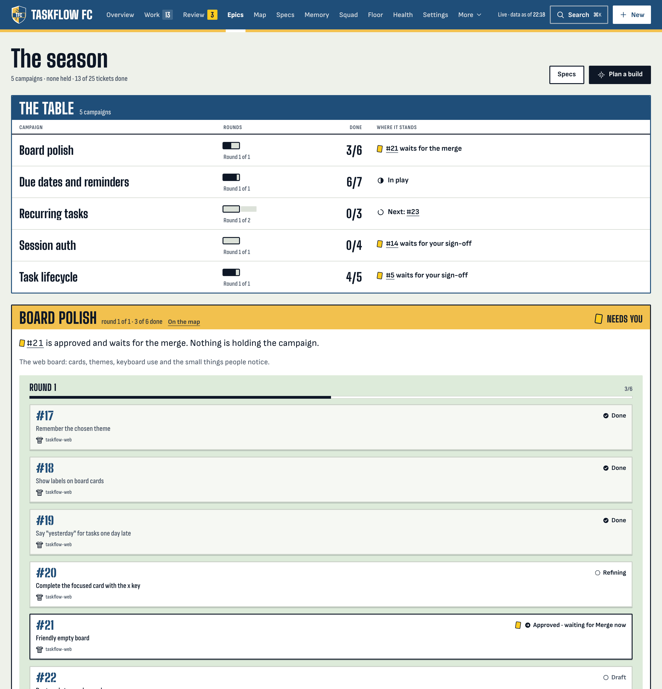

*The season (`#/epics`): each campaign's rounds, how many of its tickets are done and
where it stands, with one campaign opened below.*

## Specs: a frozen statement of intent in front of the planner

A spec is the optional power path in front of the planner; the one-line brief still
works on its own. In the Plan a build composer, the spec step drafts a spec from your
brief (`runner/bin/spec-author.mjs`, with the brief quarantined as untrusted text): a
list of clauses, each a requirement, a non-goal or a decision. You edit the clauses and
press **Freeze**, which takes an immutable snapshot. Freezing seeds each clause into
Memory as draft lore of its kind, so once approved it reaches every delivery agent's
product context like any other intent lore.

The planner then takes the frozen spec as one more quarantined input, and each
acceptance criterion it writes records the clause it covers. The **Specs** view
(`#/specs/:id`, backed by `GET /specs/:id/coverage`) shows each clause with its covering
criteria, which are satisfied and which are open, and the clauses no ticket covers.
`GAFFER_SPEC_COVERAGE_GATE` only sets an advisory flag in that coverage read; nothing
blocks on it. The same objects are on the MCP server (`create_spec`, `get_spec`,
`freeze_spec`) and the CLI (`gaffer wg spec`).

## The work board

Tickets flow through draft, ready, in progress, blocked and review lanes:

- **Draft**: being shaped. Acceptance criteria are added before a ticket can go ready.
- **Ready**: claimable. A ready ticket with no repo it may write to is parked as
  blocked (`no_write_repo`); one whose write repo has no local checkout as
  `no_local_repo_path`.
- **In progress**: claimed by an agent (the card shows which).
- **Blocked**: surfaced for a human, not retried forever. Park a ticket yourself with
  `gaffer wg block <n> --reason "..."` and send it back with `gaffer wg unblock <n>`
  (`--to` picks where). An agent blocks only its own claim.
- **In review**: delivered, awaiting your sign-off.

Every card carries a risk badge, a priority and live acceptance-criteria progress
(`2/3 satisfied`). The board is live: the control plane streams its event log to the
browser. It stays usable with years of history: the Work view loads a window of each
lane with the true counts in the lane heads, and the rest is one link away in the List
view.

**A ticket's contract can be fixed until it is claimed.** `gaffer wg ticket edit <n>`
changes the title, description, policy pack or priority; `gaffer wg ac edit <n> <ac>`
and `gaffer wg ac rm <n> <ac>` correct or remove a criterion (REST: `PATCH
/tickets/{id}` and `PATCH`/`DELETE /tickets/{id}/acceptance-criteria/{acId}`). So every
ready-gate refusal names something you can fix: `DESCRIPTION_REQUIRED` with
`ticket edit -d`, `AC_VERIFICATION_REQUIRED` with `ac edit --verify`,
`REVIEWER_REQUIRED` with `ticket set-reviewer`, `HUMAN_APPROVAL_REQUIRED` with
`ticket approve-ready`. From claimed on the contract is frozen (`CONTRACT_FROZEN`)
until the ticket comes back for rework, because the review and the tester are held to
the contract the delivery saw. The tester's test contract stays editable through
`in_review`.

**Machine-checkable criteria.** Give a criterion a check command (`npm test`, a
script, an HTTP probe) and the runner executes it in the delivery worktree after the
Definition-of-Done gates. Exit 0 marks it satisfied as runner-verified with the output
as evidence; a failure sends the delivery back with that output. The repo page holds
the gate commands (test, lint), detected at onboarding and editable there. The
typecheck gate runs the repo's package.json typecheck script, read from the base
branch; `GAFFER_DOD_TYPECHECK_CMD` overrides it. The coverage command on the same page
is not a gate; it feeds the idle coverage scan.

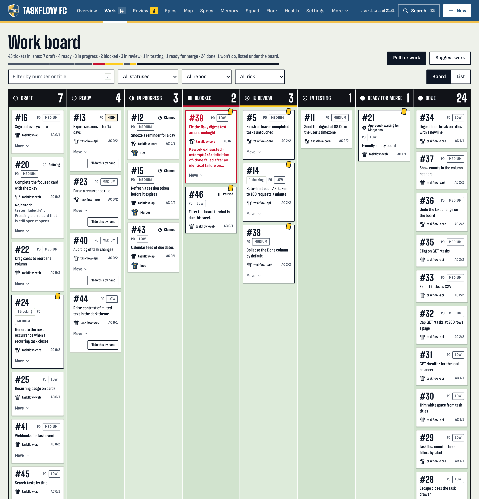

*The work board: drafts being shaped, ready work, three tickets claimed by agents,
a blocked and a paused ticket, three in review, one in testing, one approved and
waiting for Merge now, and the done lane.*

### The club, the squad and access

- **The club and the squad.** The header crest carries the club's name and short name
  (`/api/club`); with the full token it opens *Name your club* (name, crest letters,
  two kit colours, with a contrast guard). Every agent is shown by its display name and
  shirt number. The **Squad** page (`#/squad`) renames an agent in place; a taken shirt
  number is refused with the holder's name.
- **Read-only access.** A read-scoped token (Settings → Access,
  `wg principal create <name> --read`, or `print-read-token` with the dashboard's
  `GAFFER_DATA`) sees a "Read-only access" strip and every control that would change
  something switched off, on every view. The page never sends such a token's write.
- **Scoped access.** A principal scoped to repositories and tickets (Settings → Access,
  or `wg principal create <name> --repo <name> --ticket <n>`) sees only its tickets,
  opens on the Work board, keeps the controls on its own tickets and finds every
  factory-wide control switched off. Repository-level changes need an admin principal.
- **Who the CLI is.** `wg whoami` says who writes are recorded as: `$USER`, asserted,
  without a token; with `GAFFER_PRINCIPAL_TOKEN=<token>`, `wg`, `gaffer approve` and
  `gaffer merge` act as that principal, its read-only flag and scope enforced as on the
  API. `ticket create --repo <name>` gives a new ticket its write repo in one step.

### The Overview, the Floor and Health

**The Team sheet** on the Overview lists everything waiting on you, one action a row:
decisions, sign-offs, approved changes to merge, blocked tickets, a delivery paused at
a cap (Continue offers Continue and Stop) and one row for the lore drafts awaiting
approval. *Delivered today* counts the tickets that landed since midnight UTC. The
scoreboard headline leads with the work, not the number ("Webhook delivery #10 is
blocked by a failing test.").

**The Floor** (`#/floor`) draws the live factory as an isometric floor: stations along
a conveyor in lifecycle order, one parcel per open ticket, a robot in the agent's shirt
number on every live claim, a jam bay for blocked, paused and failed tickets, a spend
tank against the daily budget and a lorry carrying what was done today. Everything on
it is a link, and the stations are listed as text under the drawing.

**Health** (`#/health`, `GET /api/health`, and `gaffer wg stats` in the terminal) reads
the usage ledger and the transition log, and says only what those can show:

- **First-pass acceptance**: the share of done tickets nobody sent back after they
  first entered review and that were never reopened, split by who approved them.
- **Human review time**: the median over accepted tickets of the time from a person
  opening the ticket in Review to their decision, summed over its rounds, with p75 and
  p90, and an *active* figure capped at two hours per round. It is time with the page
  open, not reading time; tickets only an agent approved are counted apart.
- **Per accepted change**: the spend of every attempt on every ticket (parked, failed
  and abandoned ones included) divided by the tickets that reached done.
- **Escaped defects**: the share of accepted changes a person later linked a defect to.
  Link one on the later ticket's page (the *Escaped defects* card) or with
  `wg ticket regression-of <ticket> --of <change>`. Gaffer never guesses a regression,
  and an agent can neither file nor withdraw one.
- **Lane verdicts and what each lane changed.** The reviewer agent, the security
  reviewer, the tester and the eval judge each record their verdict
  (`ticket.lane_verdict`, runner-recorded only). Health counts how often each differed
  from your decision on the same attempt, how often it alone asked for a send-back, and
  its cost per attempt. These are counts; nothing switches a lane off from them.
- **Rework**: a ticket is sent back when a reviewer or the tester rejects it or the
  runner retries it after a failed gate. *Spent on rework* is the delivery spend of the
  attempts after the first send-back.
- **Flow efficiency**: the median share of a shipped ticket's lead time with an agent
  working on it. Review, testing, the merge queue, send-backs, holds and the time before
  work started are waiting, each shown on its own.
- **Review rules from your feedback.** When the same send-back reason or must-fix
  comment from a person turns up on three tickets in a repository
  (`GAFFER_REVIEW_RULE_REPEAT`, 2 to 20), the next one proposes it as a repo-scoped lore
  `convention` draft tagged `review-rule`. You approve or reject it like any other
  draft; it never approves itself, `MEMORY_AUTO_APPROVE=1` included. Only a person's
  feedback counts. `wg review-rules` lists the candidates and each rule's measure
  (rejections citing it before and after approval, or "not enough data").

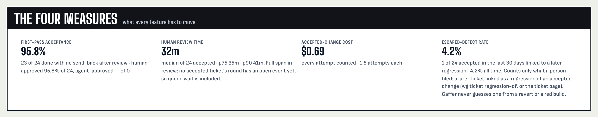

## The human review gate

When an agent delivers, the ticket lands in **Review**, the structural barrier the
design hangs on. The agent cannot approve or merge its own work (enforced
server-side unless you opt into agent approval, see
[Control you opt into](#control-you-opt-into)), and the diff you review is the real
`git diff`, computed server-side from the delivery branch, not a summary the agent
wrote. How each of these is enforced, and its limits, is in
[SECURITY.md](../SECURITY.md#the-review-gate).

### What the Review view shows

- **What was asked**: the ticket's description, above everything else.
- **The verdict strip: the runner's facts, not the agent's words.** Each
  Definition-of-Done gate (passed, failed or skipped, with the command it ran), the
  test count the runner saw in the gate's own output, the independent tester's verdict
  and the commit it tested, cost and turns so far, the attempt and who sent it back
  before, the risk level with its reasons, and the reviewed-commit pin. The
  acceptance-criteria table shows each criterion's check command and the runner's
  exit code, or **no machine evidence** when only the agent's word backs it. When the
  agent's summary claims a whole-suite count the runner's output contradicts, a flag
  says so ("the summary says 42, the runner saw 40"). On a reworked ticket the strip
  shows only this round's facts. It is one read
  (`GET /tickets/:id/dossier?include=packet`), with no model call.
- **The candidate.** For each write repo, the commit the gates ran on, the commit the
  diff shows (the one Approve binds to), the commit the tester tested and the review
  pin, side by side: **One commit** when they agree, **Differs**, **Unknown** or
  **Moved** when they do not. The **CI** cell shows the latest result for the
  candidate commit.
- **What backs this, and what is not backed.** Beside the flags, the facts behind the
  delivery in two lists, each with its source: the gates, the checked criteria, the
  tester, required CI, whether a gating test changed, a risk the scout raised, and that
  nothing has run the change as a user would yet. There is no score.
- **The Behavioural surface**, above the diff, lists what the change touches, worked
  out from the diff and the tree with no model: exported declarations added, removed
  or changed (TypeScript, JavaScript, Python), migrations and DDL, config files,
  environment variables read or no longer read, dependency changes, generated files,
  changed modules no test in the change imports, routes, and repos that depend on this
  one in the Map. For each changed exported symbol it lists the files that import it,
  which of them have tests, and the tests that import it, from the
  [code index](#the-code-index) and labelled as a lower bound. Each line says how it
  was found and links to its file. It is advisory: nothing gates on it.
  `GET /tickets/:id/diff?include=impact` returns the same facts.
- **The eval judge's grade, when you turn it on** (`GAFFER_EVAL_JUDGE=1`): a verdict
  and score on five dimensions with the judge's reason for each low one, collapsed
  behind *Show the judge's view* so you can decide without it (the ticket page and
  `wg ticket show` keep it hidden too while the ticket is in review). Opening it before you
  decide is recorded, and `gaffer eval agreement` then counts your decision apart from
  the blind ones its figures come from. Nothing gates on it, and only the runner records
  one. `gaffer eval agreement` says whether it is worth its cost on your factory; see
  [docs/eval-harness.md](eval-harness.md#is-the-judge-worth-having).
- **A request for a human is never "Nothing flagged".** The runner's
  `needs_human_review` notes, a reviewer agent's CHANGES, a tester's FAIL or hold, a
  merge-gate hold, a flagged gate and a risk escalation head the flags and sit in a
  yellow band beside the button.

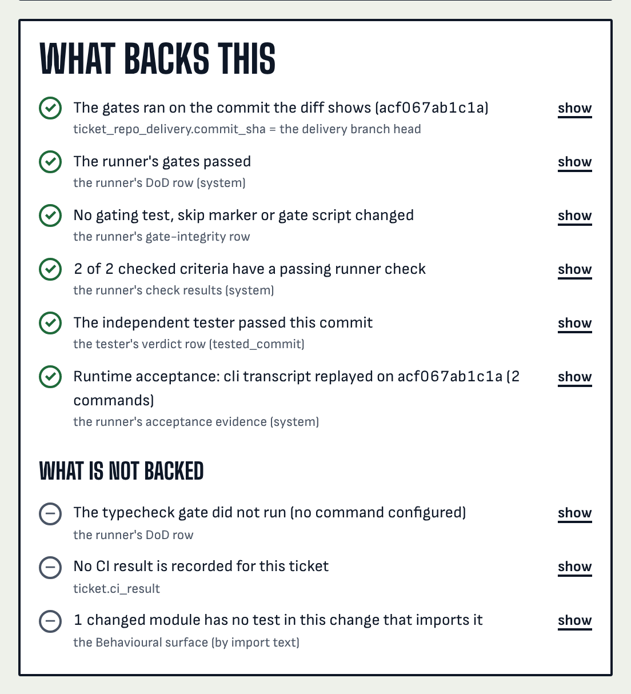

*What backs this, beside the flags: each fact with where it came from, and what nothing
has backed yet.*

### Comments, send-backs and approval

- **Comment on the change.** The + beside a diff line (either side), Comment on this
  file, Comment on the change, or `c` on a line opens a comment, marked Must fix or
  Consider and anchored from git at the commit you saw. Resolving, reopening and
  withdrawing are yours alone. **Fix these (N)** sends the ticket back to Refining
  with the open must-fix comments as numbered requirements; the next delivery prompt
  lists each one, and the agent's reply to each reads as "the agent says" (a claim,
  never a resolution). From a terminal: `wg review comment <n> --file <path> --line <n>
  --body "..." --must-fix`, `wg review comments <n>`, `wg review resolve <id>`,
  `wg review fix <n>`. Open comments are a flag, not a hold.
- **The next attempt opens on what changed since your review**, with **Whole change**
  one click away. Each earlier comment says whether its anchor changed. While the page
  is open it checks the heads every 20 seconds, and a branch that moved turns Approve
  off.
- **Approve stays disabled until the diff loads**, and is bound to the commits you
  read: a branch that moved between the diff and your click is refused
  (`409 stale_revision`) and the view reloads the new diff. `wg review approve` takes
  `--commit <repo>=<sha>` (the values `wg ticket diff <n> --heads` prints), and
  `gaffer approve` shows the commits and asks first. Every landing path merges only the
  approved commit and holds a branch that moved past it until it is re-reviewed.
- **The button says what the click does**, worked out by the server from the same
  settings and state the approve path reads: *Approve and land now*, *Approve, lands on
  next tick*, *Approve, merge is a separate click*, or why it is held (*not tested on
  this commit*, *CI not passed*, *<repo> unavailable*, *tests changed, a person must
  allow it* for an agent's approval). After approval the button says where the change
  went.
- **Approve does not merge unless you ask it to.** With `AUTO_MERGE` off (the default)
  an approved ticket waits in Ready for merge for **Merge now**; with it on, a human
  approval lands on its own (an agent's also needs `MERGE_ON_AGENT_REVIEW`, or an earned
  per-repo grant).
- **Reject** sends the ticket back for rework (or abandons it) with your reason, and
  resets its criteria. A **won't-do** keeps its branch as a record, outside the repo's
  open-branch cap.
- **A delivery that changed its own tests** is flagged by the gates' integrity row
  (deleted, renamed or skipped tests, gutted test files, changed gate scripts or runner
  config, a package-manager rc file), and the sign-off shows a banner naming each
  change. An agent approval is held for a person; **Allow test changes...** (or
  `gaffer wg ticket allow-test-changes <n> --reason ...`) is yours alone, and does not
  change what the gate runs.
- **A flaky test does not burn an attempt.** With a worker pool a red tests gate is
  rerun once at concurrency 1; a pass on the rerun is a green gate marked **Flaky
  suspected**, with the first run's output kept. `GAFFER_DOD_FLAKY_RERUN=0` turns it
  off.

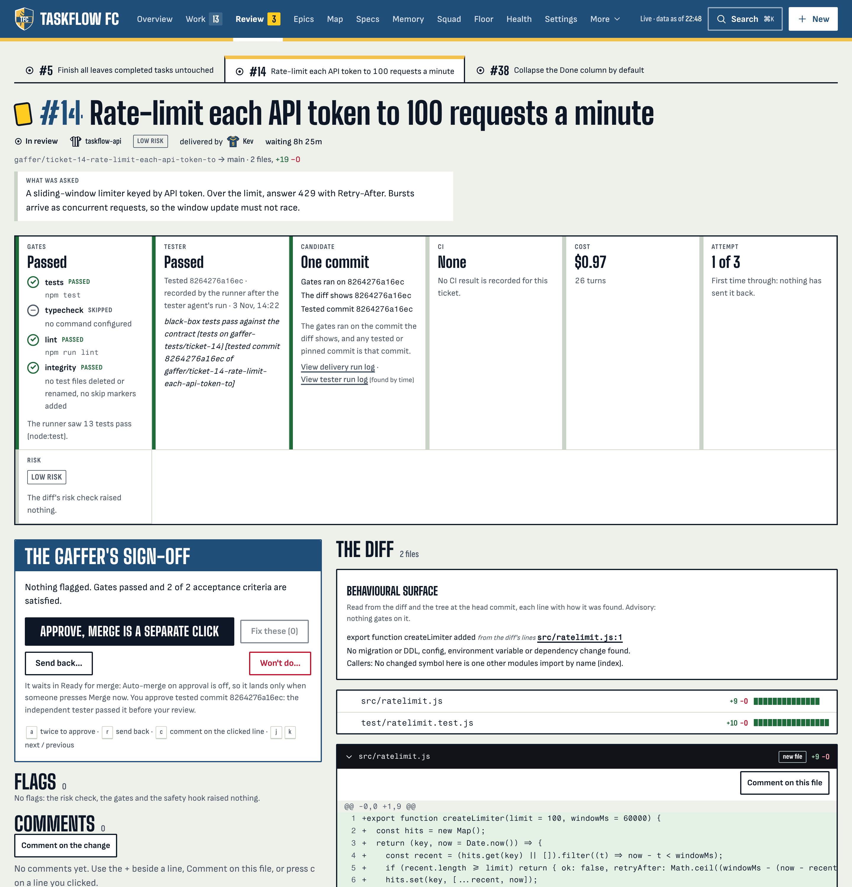

*The sign-off for a delivery the tester passed, waiting for a person: the runner's
verdict strip above, Approve beside the flags, and the server-computed diff.*

### Landing

- **An approved ticket's status says where its landing is**: *Approved · waiting for
  Merge now*, *Approved · lands next tick*, *Approved · landing*, *Approved · partly
  landed*, or the hold's own words (*Held · moved since review*, *Held · approval does
  not cover every repository*, *Held · merge gate failed*, *Held · CI red*). The
  ticket page's *Your move* offers the action that clears it, and the page turns to
  Done live when a landing completes.
- **"Done" means the combined code passed the gates on the target.** Before anything
  lands, the factory builds the merge of the approved commit onto the current default
  branch in a scratch worktree, runs the repo's gates on it, and lands exactly that
  commit only while the default branch has not moved. A red combination waits in your
  queue (`merge_gate_red`) with the default branch untouched. In PR mode the gate runs
  on the freshly fetched remote default before the PR merge is requested.
- **The tester's assertions run on what lands.** The same scratch merge also runs the
  tester's test files under the repo's registered test command, and every test the
  tester's PASS named must run and pass; a skipped, missing or failed one holds the
  landing (`tester_replay_unverified`, `tester_replay_red`). When the candidate lands,
  the runner records which tester assertions passed on which landed revision, and an
  epic counts as **accepted** only when its acceptance ticket has that record.
- **A multi-repo ticket is done when every repository landed.** An approval must cover
  every write repository, each lands through the merge gate on its own, and a ticket
  where one landed and another could not reads **Partly merged** and can only be
  finished, never cancelled. A recorded pull request lands only through that PR.
- **A cancellation or a red check during the merge gate stops the landing.** Every
  landing path re-checks ticket, approval and CI right before a default branch moves;
  a landing that had already started is reported, never read as a clean merge.
- **Required CI is required.** With *Require CI green before review* on, approval and
  a tester PASS need a passed result for the exact commit under review, and a red
  result for an approved ticket holds it (`ci_red`).
- **Landing never overwrites a file you ignore**; the ticket is held naming the file.
- **A merge conflict is never force-resolved.** The resolver agent's resolution is
  gated again on a clean checkout (no conflict markers, the repo's gates green) before
  the ticket goes back to review; one that fails is moved off the branch and held.
- **The merge commit says where it came from**: `Gaffer-Ticket: #12`,
  `Gaffer-Reviewed-By: human:tom` and `Gaffer-Gates: DoD PASS (tests pass, lint skip);
  AC 3/3 satisfied; tester PASS` trailers, read from the dispatch database. They are
  not signed. `GAFFER_PROVENANCE_TRAILERS=0` turns them off.
- **The event log is tamper-evident.** Every event is hash-chained and carries the
  runner tick that wrote it; `dispatch events verify`, `dispatch doctor` and Health's
  Event log card check the chain.
- **Every attempt names its model and its CLI version**, on the usage-ledger row and
  in the ticket page's **Attempts** history.

## The Factory Map

Real products are several repos. The **Factory Map** models that: scope nodes group
repos into products, systems and capabilities, and each repo is linked into a node
with a relation and a default access level (`write`, `read`, `test` or `none`).

Scoping a ticket to a node turns the node's repos into suggestions on the ticket. You
confirm which ones the ticket gets, one click per repo; until at least one is confirmed
at `write`, `ready` refuses the ticket (`SCOPE_REPO_UNCONFIRMED`). Once confirmed, the
access is a boundary the runner enforces: the agent writes only to the `write` repos
and reads the `read` ones. Repos with no mapping behave as standalone single-repo
scopes, so nothing has to be mapped to start.

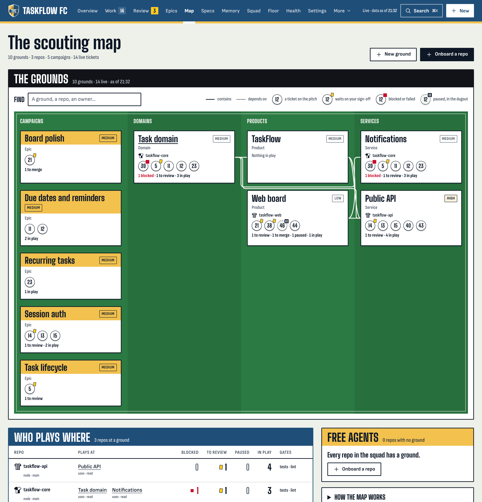

*The scouting map (`#/map`): each ground with the repos mapped to it and its tickets
in play, blocked or waiting on you, and which repo plays where.*

## Durable repo memory

Gaffer doesn't re-learn a repo from cold on every run. **Memory** is the durable,
human-gated knowledge the factory works from:

- **Repo Digest**: a living summary of each repo's overview, structure, conventions
  and stack, seeded at onboarding and refreshed as tickets merge, with a freshness
  stamp and the caveat that it is a map to verify against the code. Onboarding reads
  only files inside the repository and strips credentials from remote URLs.
- **Feature ledger**: what is backlog, building and shipped per repo, so the factory
  knows what already exists before it proposes building it again.
- **File cards**: one per source file (path, symbols, content hash, a short summary),
  used to choose what to read before a ticket. After every merge they are brought in
  line with the merged commit, renames included, and checked against it before memory
  records the repo as indexed there.
- **Lore**: the team's recorded conventions, decisions, gotchas and cross-repo
  boundaries. Agents draft lore through an MCP review gate, and a human approves it in
  the Memory view or from the terminal (`gaffer lore review`, `gaffer lore show <id>`,
  `gaffer lore approve <id>`, `gaffer lore reject <id> --reason "..."`). An agent shell
  can't run these. Lore is never silently rewritten: every edit snapshots the previous
  version (`memory history <id>`).

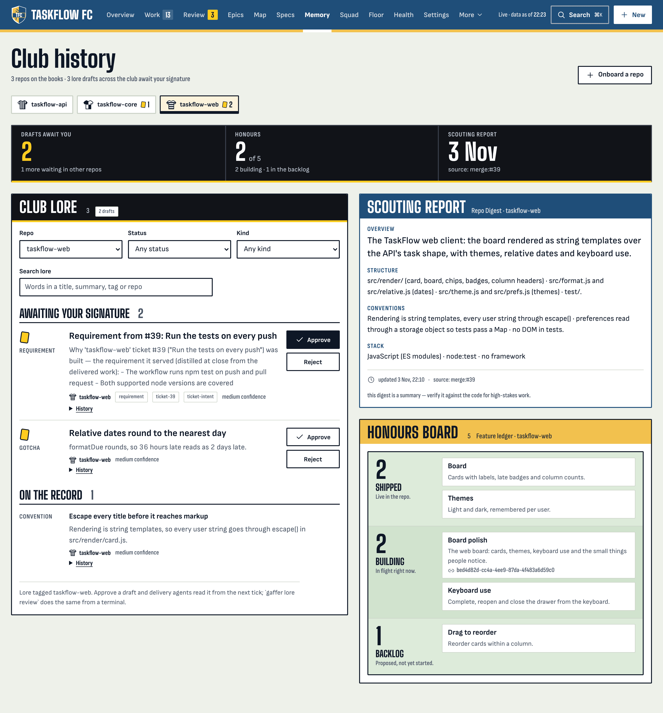

*Club history (`#/memory`) for one repo: its digest, the feature ledger, and the lore
delivery agents read, with a draft waiting for your signature.*

Memory is also usable standalone; see
[`packages/memory/README.md`](../packages/memory/README.md).

### The code index

`memory index build | neighbours | stats` maps each repo's TypeScript, JavaScript and
Python files, top-level symbols, imports and tests, read from the text with no model.
Imports resolve relative paths, `index` barrels, `./x.js` for `x.ts`, workspace package
names, tsconfig `paths` and Python packages; a test links to the modules it imports and
the one its file name names. It is built at onboarding and refreshed after every merge,
re-reading only changed files, with generated and vendored paths skipped and the walk
capped (a capped build says its counts are partial). When a ticket names a path or a
symbol, the delivery's context lists up to five callers and tests of each, with the
reason. Health shows each repo's index coverage. `GAFFER_CODE_INDEX=0` turns it off.

### The pre-work scout

Before a delivery starts, the runner works out where the change likely lands, with no
model: the files the ticket names, the files in a stack trace it quotes (matched to the
tree; an ambiguous frame is listed as not placed, never guessed), and what the code
index says imports or tests them, two hops at most. At most 25 files, each with why it
was picked, plus the repo's test command, reach the delivery prompt as one SCOUT block
inside an untrusted envelope. The same pass classifies risk from deterministic signals
(a migration or schema file, an auth path, a package entry imported elsewhere, race
words, more than one write repo, a previous send-back, a symbol with 10 or more
callers, a module no test imports): it can only raise the declared level, never lower
it and never to critical. The router routes on the raised level, and the Review packet
shows it. Each launch also logs what context it was given to
`context-selection.jsonl`. `GAFFER_SCOUT_PACKET=0` turns the packet off.

**A bounded model scout, when you turn it on.** `GAFFER_SCOUT=auto` adds one read-only
model call for a ticket whose effective risk is medium or higher (`on`: every delivery;
`off`, the default: never). It reads the repo with Read, Grep and Glob only, for
six turns (`GAFFER_ROLE_MAX_TURNS` `scout=`), on the cheap tier, and answers with at most 8 files,
8 symbols, 10 notes and 3 questions; the runner keeps a path only when it exists and
shows the rest as a model's reading. It is booked as kind `scout` under the usage
ledger and the budget, and it does not run under the command worker.

### Routing evidence: manifests, a scorecard and matched experiments

The router picks a tier from risk, size and history; this is the record of how each
choice turned out. **Every delivery attempt leaves a replay manifest** under
`$GAFFER_DATA/manifests/<ticket>-<n>.json`, opened when the agent is spawned and
completed however the attempt ends: each write repo's path, base and head commit and
test command, the router's tier, model and reasons with the declared and effective
risk, the settings that shaped the attempt, sha256 hashes of the prompt and scout
packet (never their text), the usage-ledger attempt id and the outcome with its gate
rows. It is capped at 16 KiB, a test command loses anything that looks like a
credential, and a write failure never holds up the delivery.

**The routing scorecard** (a Health card, `routing_scorecard` in `GET /api/health`,
`gaffer wg stats routing`) splits the work by provider, model, role and work class.
Each cell shows calls and spend (estimates labelled, unknown-cost calls counted and
left out), and for delivery the attempts, submissions and rework, first-pass
acceptance, attempts and cost per accepted change, escaped defects and tester false
greens. Every figure shows its n; a cell with fewer than 10 attempts reads *too few to
compare*. Nothing is ranked, there is no overall score, and the router does not read it.

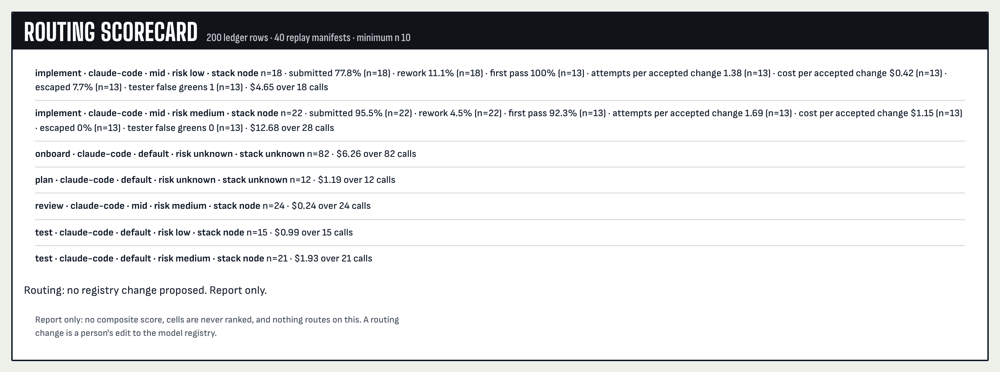

**Matched experiments.** `gaffer eval experiment --arm baseline --arm cheap:tier=cheap`
runs the same tickets (the gate-replay fixtures, or recorded tickets from their
manifests) once under each arm, in a seeded order, through the same worker seam and
gates a tick uses, and writes `results.json` and `report.md` with the paired difference
per ticket in acceptance, attempts, spend and judge score, with mean, 95% interval and
n (acceptance, a paired yes or no, uses Newcombe's paired score interval and reports
the discordant tickets; the rest use a paired t interval). By default a stub agent replays the recorded change, so it is free and runs in CI;
`--live` runs the real agent under a hard USD cap (`--max-usd`), a ticket cap and the factory's budget admission and usage
pause, and records nothing to dispatch. [docs/eval-harness.md](eval-harness.md#matched-ticket-comparison)
has the arms, the report and the limits.

**Recommendations you apply.** `gaffer wg routing recommend` reads the scorecard and
any experiment results and, where another tier is cheaper per accepted change and no
worse on first pass and escaped defects in every work class with enough evidence, or a
live experiment against the default tier shows it cheaper with at least one discordant
ticket and an acceptance interval whose lower bound is within a 0.10 non-inferiority
margin, prints a proposed
`runner/model-registry.json` change as a diff with the cells and deltas behind it. It
never edits the registry and never proposes anything for the reviewer or the tester.
Health carries one Routing line saying whether a proposal exists.

### Backing up the board

`gaffer wg export --out board.json` writes the whole board (tickets, epics, scope graph,
criteria, repos, decisions, reviews and evidence, the event log, claims, planner
sessions, paused deliveries) as one JSON bundle; `gaffer wg import` restores it into an
empty database, and `import --force` replaces every one of those tables. The export is
one consistent snapshot, read in a single transaction without blocking writers, and it
restores its own bundle into a scratch database before it writes the file, so a bundle
it reports as written is one it has restored. Run-activity rows, API credentials and
schema metadata are machine-local and not exported.

## Control you opt into

Gaffer is supervised by default: a human readies tickets, a human approves merges, and
memory drafts wait for review. **Settings** is where you decide how much of that to
hand over, and every autonomy flag is off until you turn it on:

| Flag | Effect when on |
|---|---|
| `DISPATCH_ALLOW_AGENT_APPROVE` | An agent actor may approve a ticket's review (otherwise human-only). |
| `AUTO_MERGE` | Land a human-approved ticket on the default branch without a second click (off: it waits for Merge now). |
| `MERGE_ON_AGENT_REVIEW` | Extend `AUTO_MERGE` to approvals made on an agent reviewer's verdict. Needs `AUTO_MERGE` too: alone it merges nothing (the run says so). |
| `REVIEW_MODE=both` | The agent screens first (a CHANGES verdict can bounce the delivery to rework) but a human still confirms every approval. |
| `MEMORY_AUTO_APPROVE` | Let the memory the runner itself files (the requirement distilled from each delivered ticket, onboarding induction lore, CLI `memory suggest`) go live without a human review step. Lore a delivery agent suggests over MCP always stays a draft, and a draft is invisible to other agents (search, duplicate hints, fetch by id) until you approve it. |

`GAFFER_MODE` sets the whole cluster at once (supervised, lite, graduated, autonomous,
strict); [CONFIG.md](CONFIG.md) lists what each sets. Whatever the mode, every agent runs
inside an OS sandbox (`sandbox-exec` on macOS, `docker` where Docker is installed): a
host without one refuses to launch agents, before anything is claimed, and says what to
install. Settings shows that posture as a read-only line in its Sandbox group: the
provider, available or missing, required or opted out, and the fix. The opt-out is
`GAFFER_STRICT_REQUIRE=0` in the environment, for a runner you contain yourself; with a
ship or mutate flag on as well, the runner warns about it twice
([docs/sandbox.md](sandbox.md)).

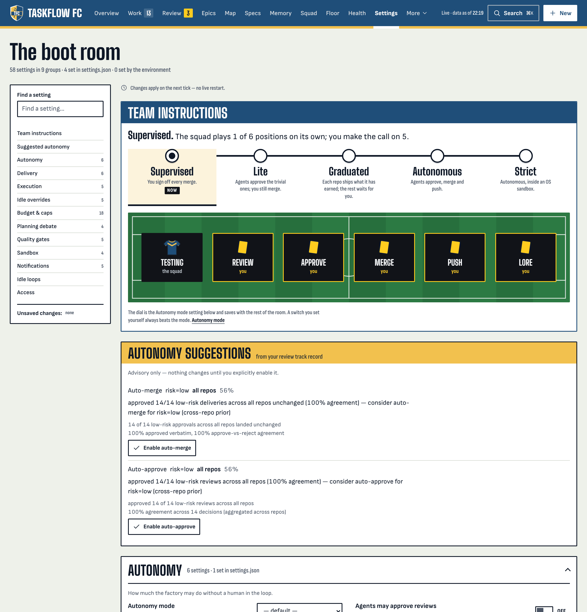

*The boot room (`#/settings`): the Team instructions dial on Supervised, and below it
suggestions for what could be handed over, from your own review record. Nothing
changes until you enable one.*

### The independent tester

With `GAFFER_TESTING` unset (the default), the tester lane is on for a ticket whose
write repos all have a registered test command, and off where one has none (a tester
PASS there could not be replayed); Review and Health say so in one line.
`GAFFER_TESTING=1` turns it on for every testable ticket and `0` turns it off; an
epic's acceptance ticket is always tested. A planned build's tickets are created
testable unless the lane is off, and any ticket can be switched on its page or with
`wg ticket set-testable <n>`.

When the tester gates a ticket it runs after the gates (and the reviewer agent, when
you run one) and before you look: a PASS brings the ticket back to Review with the
tester's verdict and the commit it tested, and a FAIL sends it back to rework with the
tester's observation in the next prompt. You approve the commit the tester passed; if
the branch moves or the contract changes, the approval is refused (*Approve held: not
tested on this commit*) and the runner sends the new head to the tester first. With CI
required, a delivery goes to the tester only once CI has passed on its head.

The dashboard and the runner each read `GAFFER_TESTING` from their own environment;
the value saved in Settings reaches both, and an explicit environment value wins. If
the two differ, Health and the Review view say *tester lane differs*.

A ticket that becomes testable with no test contract gets one from its title; replace
it with `wg ticket test-contract <n> --surface ...` until testing starts. A tester
PASS counts only when the runner replayed the tester's tests on a clean checkout of
the tested commit with the repo's registered test command. The tester wrote those
files, so the replay runs them inside the same sandbox as the gates (`docker`, or
`sandbox-exec` with reads of `$GAFFER_DATA` and your HOME's secret folders denied), with
no model credential, no factory data and no `wg` in reach. If strict mode is on and this
host has no sandbox, the PASS is held with that reason rather than replayed bare. With no test command (or
`GAFFER_TESTER_REPLAY=0`) the PASS is held in Testing, with a note saying how to
register one (`wg repo set-commands <repo> --test "<cmd>"`). You can record the verdict
yourself: **Record tester PASS** (reported as a waiver) or **Record tester FAIL** on
the ticket page, or `wg ticket tester-pass <n> --as human`.

### Acceptance profiles

A ticket's test contract can name how the tester's PASS is proven. `unit` (the default)
is the tester's tests replayed, as above. With `cli` or `api`, the runner also runs
commands you register, in a fresh checkout of the tested commit, and records the PASS
only when they behave as you said:

- `cli`: each command is an argv list (never a shell string) with optional stdin and
  env, and expectations: the exit code, stdout and stderr substrings or `/regex/`, text
  stdout must not contain, and files that must or must not exist afterwards.
- `api`: a boot argv, the env var that gets the port (`PORT` by default), a health path
  and probes (method, path, headers, body; the expected status, body substrings, JSON
  keys and a `schema_ref` into a schema file in the repo). A probe that should be
  refused expects its 4xx.
- `web`, `migration`, `performance`: defined so you can record what should be checked,
  but not run yet, so a PASS on such a ticket is held for your verdict.

Set the profile on the ticket page (**Acceptance profile** in the Independent testing
card) or with `wg ticket acceptance-profile <n> --profile cli --spec-file cases.json`,
until testing starts:

```json
{ "cases": [ { "argv": ["node", "bin/cli.mjs", "--version"], "expect": { "exit": 0, "stdout": ["1.2.0"] } } ] }
```

The delivery agent can raise a unit contract to a profile but never registers commands
or changes a profile you set; a profile with no commands holds the PASS until you
register them. The Independent testing card lists what ran under **Runtime acceptance**
with the transcript, and Review's *What backs this* names it. Each command has a time
cap (30 s by default, `timeout_ms` per command) and the whole profile one more
(5 minutes). `GAFFER_ACCEPTANCE_PROFILE_SEED=1` (off by
default) seeds the profile, without commands, for a ticket whose title names a CLI or an
API. What a profile does and does not prove is in
[SECURITY.md](../SECURITY.md#the-independent-tester-and-what-its-verdict-proves).

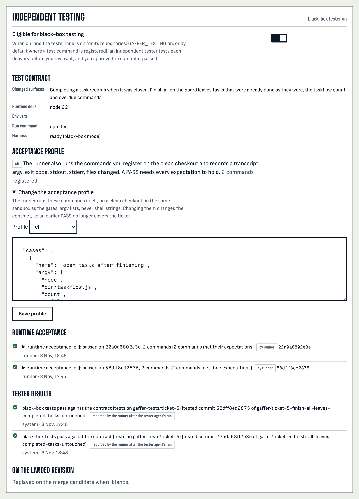

*The Independent testing card on a ticket page: the contract the tester read, the
acceptance profile, the runner's runtime acceptance result on each tested commit,
and the tester's passes.*

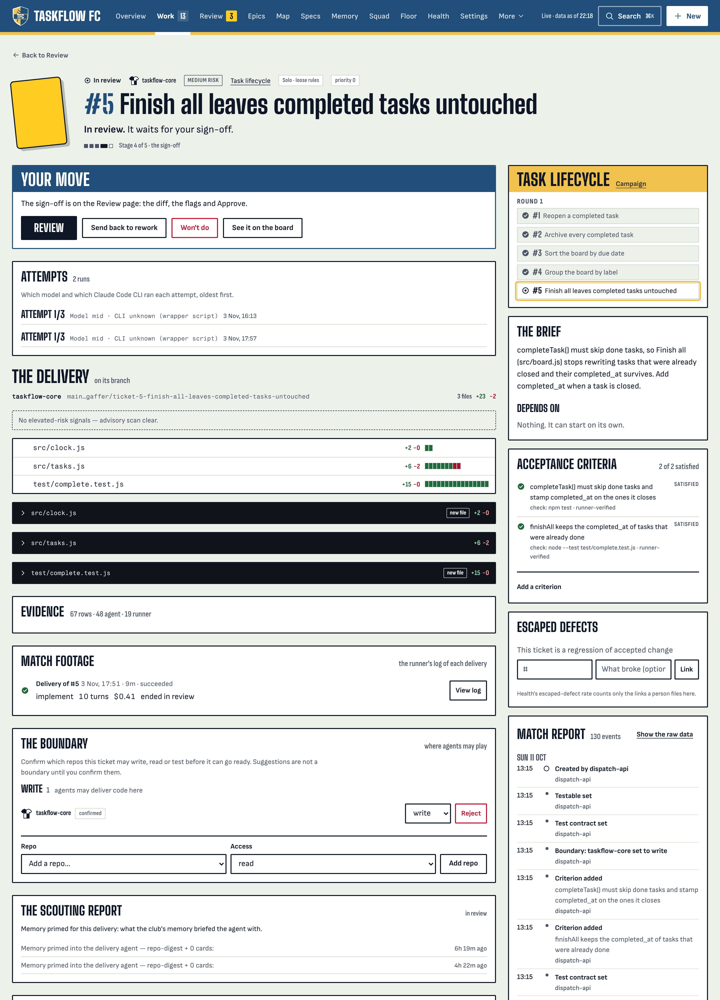

### Budget, polling and usage limits

- **A dollar cap before the first live run.** A live run (`gaffer run`, the loop,
  **Poll for work**) refuses to start until `GAFFER_DAILY_BUDGET_USD` or
  `GAFFER_BUDGET_USD` is set. In the dashboard the first Poll asks for a daily budget,
  prefilled at $5. Every other paid launch is refused the same way, checked right before
  it starts. Dry runs are never refused; `GAFFER_ALLOW_UNCAPPED=1` in the environment
  opts out.
- **One Poll at a time.** A Poll pressed while the previous one runs waits for it
  (`GAFFER_POLL_WAIT_TIMEOUT`), and each run keeps its own per-run lists.
- **Usage limits pause the factory, they do not fail tickets.** When the model refuses
  a call because the usage window ran out or a rate limit hit, the ticket goes back to
  Ready without counting an attempt and the factory pauses until the window resets (the
  printed reset time plus a minute, or `GAFFER_USAGE_PAUSE_DEFAULT_MIN`, default 60).
  No tick claims work and the dashboard's model calls start nothing meanwhile;
  `gaffer status` and Health show "Paused until <time>: usage limit". A spend cap is not
  a pause: those tickets are parked for a person.
- **Secrets are never shown back.** The Slack and webhook URLs are posting authority
  on their own: the panel says whether one is set and names its host, with **Replace**
  and **Remove**.
- A value that does not fit its setting is not saved: the panel marks the field and the
  API refuses the write with a 422 naming it. Every knob, its default and who reads it
  is in [CONFIG.md](CONFIG.md).

### Idle work

- **Maintenance when idle.** With the queue empty, an idle tick can run one scan lane
  (security hotspots, coverage, test quality, type quality, tech debt, documentation,
  dependencies), chosen by a deterministic priority-and-rotation scheduler. Each finding
  becomes a draft ticket with a behaviour-preserving criterion that runs the repo's own
  test command. The coverage lane files a draft only when the coverage command succeeds
  and reports a total below `minimum_gap_threshold`. The scans cost nothing; only the
  feature backlog spends a model call. The **Idle loops** panel holds the master switch,
  the lane toggles, the dependency lane's audit command and the **self-improve** gate
  (opted-in repos, a risk ceiling and a per-tick cap under which the tick promotes its
  own drafts to ready). Off by default.
- **Feature backlog when idle.** With the toggle on, an idle tick takes one `backlog`
  feature from the memory ledger, plans it with one model call and files the epic as
  draft tickets behind the usual human gate. After two failed plans in a row it is left
  for you. Off by default.

### A different worker behind the factory

`GAFFER_WORKER_PROVIDER=command` with `GAFFER_WORKER_COMMAND=/path/to/program` runs your
own program for every agent turn: deliveries, reviews, clarify passes, planning, the
tester and the merge resolver. The program gets the prompt (in
`GAFFER_WORKER_PROMPT_FILE`), the MCP config path and the model and turn-cap hints as
`GAFFER_WORKER_*` variables, and prints a small JSON envelope. Budget admission, the
scrubbed environment, the timeout and every gate after the call work as for the default
worker, and each call is booked at no less than a per-call floor
(`GAFFER_WORKER_COMMAND_COST_USD`). It has no in-process safety hook, so it launches
only inside the docker sandbox with the host-side MCP bridge.
[worker-providers.md](worker-providers.md) has the contract.

## Skills: the right pack, mounted where the agent reads it

Every agent run (delivery, review, the independent tester, intake, planning, merge)
gets its own skill set from the factory library, chosen by role and by the ticket's
stack: the conventions pack of the language, the lenses of the role, and the packs the
ticket text calls for, never the whole library. [skill-selection-and-stacks.md](skill-selection-and-stacks.md)
has the details.

- **Every repo on the ticket counts.** A ticket spanning a TypeScript frontend and a
  Java service is selected for both stacks; files named in the ticket (or, for review,
  the diff) narrow the set to the ecosystems they touch.
- **Mounted where the agent CLI looks.** Skills are copied to
  `.claude/skills/<name>/SKILL.md` in the agent's worktree, beside a repo's own; a repo
  skill of the same name wins, and teardown removes only Gaffer's copies.
- **Use is measured honestly.** Health's skill panel shows, per skill, how often it was
  selected, applied (named in the agent's output), opened (a read the hook allowed) and
  refused (a read it blocked). A refused read never counts as use.
- **A live check, on demand.** `GAFFER_LIVE_SKILL_TEST=1 bash runner/test/live-skill-use.test.sh`
  plants a harmless token in each role's intended skill, runs the real agent CLI
  through a real tick on a tiny fixture repo, and checks each role's result for its
  token. It skips cleanly without the variable, a working CLI or credentials. Set
  `GAFFER_LIVE_SKILL_MODEL` to your cheapest model; it prints the cost.

## Where to go next

- [README](../README.md): the overview, install and safety summary.
- [quickstart.md](../quickstart.md): a guided first run.
- [SECURITY.md](../SECURITY.md): the threat model and residual limits.
- [runner/README.md](../runner/README.md): the runner in depth.
- [docs/README.md](README.md): every doc, by what you need.
