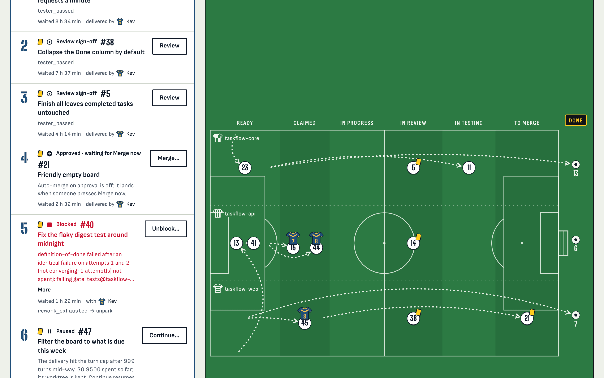
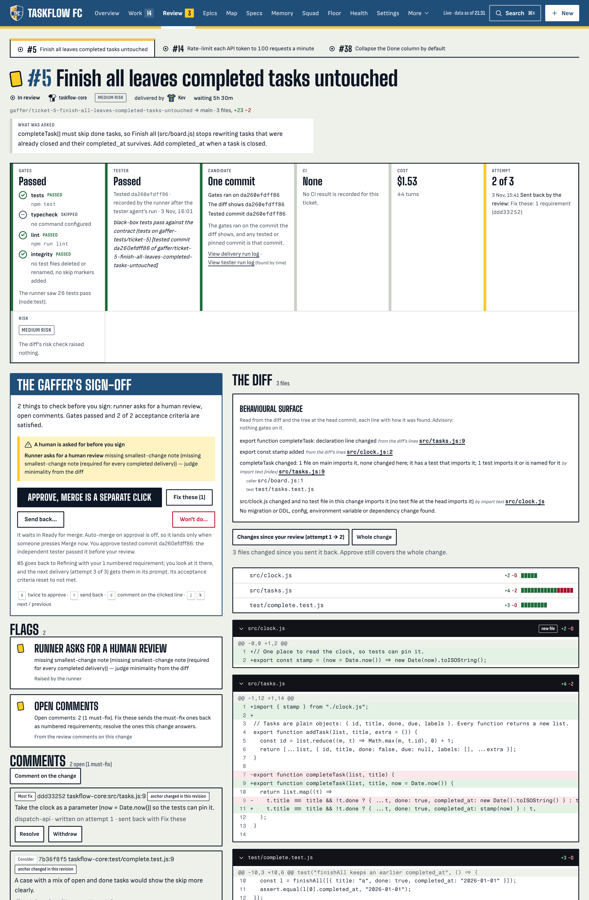

# Gaffer quickstart

Stand up the factory from a clean checkout, onboard a repo and take one ticket all the
way to your default branch. Run the commands in order.

## Prerequisites

- **Node 22.22.1+ or 24** and **[pnpm](https://pnpm.io)** (`pnpm@10.33.0`, pinned via `packageManager`). The Node floor is a hard prerequisite; see the note under step 1.
- **Git**: the factory branches per ticket, so your target repos should be git repos.
- The agent CLI (`claude`), installed and logged in, for any live run. Setup, the demo and dry runs work without it.
- **An OS sandbox** for any live run: every agent runs inside one. macOS has `sandbox-exec`. Linux needs Docker with a running daemon; `runner/gaffer setup` builds the sandbox images when it finds one, and prints what it found either way. With neither, live runs refuse to launch agents and say what to install. `GAFFER_STRICT_REQUIRE=0` in your environment runs agents unwrapped instead, for a host you contain yourself (a VM or a container).
- `sqlite3` is handy for poking the stores, but not required.

Gaffer is local-first: the control plane, databases, worktrees and evidence live on
your machine. Live agent runs send prompts and the repo context they select to your
model provider, so treat it as part of your trust boundary.

## 1. Install and initialise

From the repo root:

```bash
runner/gaffer setup
```

This installs and builds the three packages (`dispatch`, `crew`, `memory`), creates
fresh factory state under **`.gaffer/`** (the control-plane database, the memory store
and `crew.yaml`), and starts the dashboard. State lives in `.gaffer/` by default
(override with `GAFFER_DATA`); delete it to start again.

> **An older Node stops setup before it installs anything.** On Node 22.22.0, for example:
>
> ```
> Node v22.22.0 is below Gaffer's floor (engines.node ">=22.22.1" in …/package.json) — install a newer Node first, e.g. `nvm install 22 && nvm use 22` (or Node 24), then re-run.
> ```
>
> Exporting `npm_config_engine_strict=false` does not get past it: pnpm then only warns,
> but setup runs its own check and still refuses. Install Node 22.22.1 or newer (or 24)
> and run setup again.

To type `gaffer` instead of `runner/gaffer`, add `alias gaffer="$PWD/runner/gaffer"` to
your shell profile.

## 2. Onboard your first repo

```bash
runner/gaffer onboard /path/to/your/repo
```

This registers the repo and runs an analysis that writes a **Repo Digest** (what the
codebase is and how it's structured), a **Feature ledger** (the product capabilities it
ships) and cited **lore drafts** into the memory store. Re-running it refreshes rather
than duplicates. A different repository with the same directory name is refused; onboard
it under its own name with `runner/gaffer onboard /path/to/other/api --name other-api`.

> Lore lands as **drafts**. `runner/gaffer lore review` lists them (the same list as the
> dashboard's **Memory** view); keep what's worth keeping with
> `runner/gaffer lore approve <id>` and drop the rest with
> `runner/gaffer lore reject <id> --reason "..."`. Nothing is auto-promoted.

Onboarding also files one **decision**, *"Onboarding intake for '<repo>'"*: a few
questions the scan could not answer from the code (what the product is for, who it
serves, what is out of scope). It blocks nothing. Answer it from the Overview when you
have a minute; the answers become lore drafts for review.

## 3. Open the control room

```bash
runner/gaffer dashboard
```

Setup already started it; this prints the `http://127.0.0.1:8787/?token=...` link again.
Open it on this machine (or paste the token at the login prompt). The dashboard binds
loopback only, and every data request needs that token.

To use another port, set `DISPATCH_API_PORT`, e.g. `DISPATCH_API_PORT=9000 runner/gaffer
dashboard --restart`, and export it in every shell you run `gaffer` from. In the
container, compose publishes the host side from `GAFFER_PORT` (default
`127.0.0.1:8787`) and falls back to `DISPATCH_API_PORT`.

> **`--lan` is plain HTTP on your LAN.** `runner/gaffer dashboard --lan` binds every
> interface so a phone or another machine can open it. There is no TLS, so the full token
> (approve, merge, run) crosses the network in the clear. Use it only on a network you
> trust; otherwise use an SSH tunnel (`ssh -L 8787:127.0.0.1:8787 <host>`) or a reverse
> proxy that terminates TLS, and give viewers a read-only token (the README says how).

`runner/gaffer dashboard --restart` rotates the login token and starts a fresh server;
`--stop` stops it. When the port is taken it says by which pid and starts nothing.

> **Wiring reference: always launch the dashboard via `gaffer dashboard`.** It wires
> every action command (`DISPATCH_PRODUCT_OWNER_CMD`, `DISPATCH_MERGE_CMD`,
> `DISPATCH_TICK_CMD`, `DISPATCH_ONBOARD_CMD`, `DISPATCH_EPIC_FEATURE_CMD`) into the API's
> environment. An ad-hoc launch (`node packages/dispatch/dist/api/bin.js`) leaves them
> unset, so the dashboard's buttons do nothing; the API logs a `dispatch-api action
> commands — wired: …; missing: …` line at startup. See [`.env.example`](.env.example)
> for the full wiring and knob reference.

The screens:

- **Overview**: the scoreboard and the Team sheet of everything waiting on you.
- **Work**: the ticket board (plan, implement, test, review).
- **Review**: the human gate, where tickets wait for your approval before any merge.
- **Epics**: tickets grouped by epic, phase by phase.
- **Map**: the Factory Map of scope nodes and repos.
- **Health**: what the factory cost, what it delivered and where it failed.
- **Specs**: frozen statements of product intent, each clause traced to acceptance criteria.
- **Memory**: a repo's digest, feature ledger and lore, and the **Onboard a repo** button.
- **Squad**: every agent with its shirt number, name and role; **Rename** renames one.
- **Floor**: the factory as a live isometric floor.
- **Settings**: every operator knob, grouped (autonomy, delivery, execution, idle loops, budget and caps, planning, quality gates, sandbox, notifications), saved to `settings.json`; a real environment variable always wins and shows read-only.

[docs/FEATURES.md](docs/FEATURES.md) walks through each one.



*The Overview of a factory a few weeks in: the Team sheet lists what needs you, and the
Tactics board shows every ticket in play by repo and stage.*

## 4. Give it your first ticket

`runner/gaffer wg` is the dispatch CLI pinned to this factory's database. Four commands
take a ticket to **ready** (or create it in the **Work** view):

```bash
runner/gaffer wg ticket create -t "Add listNotes: newest-first listing" \
  -d "Export listNotes(notes) from src/notes.js: sorted newest-first by createdAt, input untouched, with a node:test test."
runner/gaffer wg ac add 1 -t "listNotes returns a new array sorted newest-first and leaves the input unchanged"
runner/gaffer wg ac add 1 -t "test/notes.test.js covers the new function and the suite passes" --check "npm test"
runner/gaffer wg ticket repo-access set 1 <repo-name>     # the name you onboarded (see `runner/gaffer status`)
runner/gaffer wg ticket ready 1
runner/gaffer wg ticket show 1                             # status, criteria, repo access
```

The `ready` gate wants at least one acceptance criterion (one with `--check '<cmd>'` is
run by the runner itself) and a repo the ticket may write to. The default `solo_loose`
pack only warns about a missing repo, and the runner then parks the ticket as `blocked`
(`no_write_repo`); the stricter packs refuse it (see
[the aside below](#aside-readying-a-ticket-under-the-stricter-policy-packs)).
`ticket create --repo <repo-name>` does the repo step in the same command. If **ready**
is refused, the refusal names what is missing, and `wg ticket edit 1` or `wg ac edit 1
<ac>` fixes it; the contract is editable until the ticket is claimed.

## 5. Run the factory

The factory works tickets through plan, implement, test and review, each in a throwaway
git worktree, behind a deterministic safety hook. Watch it first:

```bash
runner/gaffer demo              # one dry tick over a showcase repo in a fresh temp dir
runner/gaffer run --dry-run     # preview each ready ticket once; nothing claimed or spent
```

When you're ready to let it deliver for real:

```bash
bash runner/preflight.sh              # verify the environment
export GAFFER_DAILY_BUDGET_USD=5      # a dollar cap: a live run refuses to start without one
runner/gaffer run                     # live: one pass, drains the ready queue, then exits
runner/gaffer run --daemon            # or keep going: a pass every 30 s until you stop it
```

A live run needs a dollar cap, and so does every other paid call. With neither
`GAFFER_DAILY_BUDGET_USD` (per UTC day) nor `GAFFER_BUDGET_USD` (lifetime) set,
`gaffer run` and the dashboard's **Poll for work** refuse to start and print the fix; the
first Poll in the dashboard asks for a daily budget, prefilled at $5. A dry run is never
refused. `GAFFER_ALLOW_UNCAPPED=1` in your environment opts out.

If the model refuses a call because your usage window ran out, the ticket goes back to
Ready without counting an attempt. A one-shot run stops there (exit 75,
`paused until <time>`); `--daemon` sleeps until the window resets.

A pass on the ticket from step 4 takes a minute or two: the runner claims it, the agent
works on a `gaffer/ticket-1-...` branch in a throwaway worktree, the runner runs the
Definition-of-Done gates and your `--check` commands, and submits it for review
(`in_review`). `runner/gaffer wg ticket show 1` shows the branch and each criterion's
verdict.

### Approve and merge

By default the loop never merges: that is the human gate. Approve and land the ticket
from the **Review** view (read the diff, arm and confirm Approve, then Merge), or from
the terminal:

```bash
runner/gaffer approve 1 --reviewer <your-name>   # in_review → ready_for_merge (a human approval)
runner/gaffer merge 1                            # the same merge the dashboard's Merge button runs
```



*The Review view for one ticket: what the runner recorded above, Approve beside the
flags, and the diff the control plane computed from git.*

`approve` shows the commit of each repository it is about to approve, with a diffstat,
and asks; the approval covers exactly those commits, and a branch that moves before you
confirm is refused. Non-interactively, pass what you reviewed:
`runner/gaffer approve 1 --commit <repo>=<sha>` (`runner/gaffer wg ticket diff 1 --heads`
prints them).

`merge` builds the merge of the approved commit onto your current default branch in a
scratch worktree and runs your repo's gates on that merge. Only if the combination
passes does it land that commit, mark the ticket **done** and refresh the repo's digest
and feature ledger. A combination that fails is held for you with your default branch
untouched, and a merge conflict is never forced.

> **A delivery that changed its own tests waits for you.** If the agent deleted, renamed
> or skipped a test, or changed the `test` script, the gates' **integrity** row reads
> FLAG, the Review view names each change, and an agent approval is held. If the ticket
> really should change its tests, allow it:
>
> ```bash
> runner/gaffer wg ticket allow-test-changes 1 --reason "the v1 suite is obsolete"
> ```
>
> or press **Allow test changes...** on the Review view. The allowance does not change
> what the gate runs: a gate script the delivery changed still runs as the base commit
> has it. To change the gate, change the repo's registered command
> (`runner/gaffer wg repo set-commands <repo> --test "<cmd>"`).

## 6. Build a whole new app from one line (greenfield)

You don't need an existing repo. The **Plan a build** chat turns a one-line brief into a
phased, dependency-ordered epic, starting with a **bootstrap** ticket that creates a new
repo, which the factory then onboards and delivers into.

1. **Plan it.** Command palette (`Jump to...`) → **Plan a build** → keep **New app,
   greenfield** selected → type one line (e.g. *"a full-stack calculator: a backend HTTP
   API that evaluates arithmetic expressions and a web front-end that calls it"*) → send.
   Answer the planner's questions, or press **Build the tickets** to plan with what it
   has, then **Create & ready** (or **Create as draft** to inspect the tickets first).
   From a terminal: `runner/gaffer plan "a full-stack calculator: ..."`, answer with
   `runner/gaffer plan --answer "..."` (or `--now`), and create the drafts with
   `runner/gaffer plan --yes`. Then ready them as in step 4.
   The plan always ends with **Acceptance: <epic>**, a ticket the factory adds that runs
   last against the integrated build; until the tester passes it, the build is not
   accepted.
2. **Ready them** if you created drafts (drag on the board, or
   `runner/gaffer wg ticket ready <n>` for each). Phase 1 is the bootstrap.
3. **Deliver.** `runner/gaffer run` (or `--daemon`). The bootstrap creates the repo at
   `$GAFFER_BOOTSTRAP_ROOT/<slug>` (`~/git/<slug>` unless set; `/repos/<slug>` in the
   container), and the other tickets deliver into it in dependency order.

The loop delivers to `in_review`; approve and merge each ticket as above. The bootstrap
ticket has no delivery branch, so approving it marks it merged.

### What Gaffer does on a greenfield run

Nothing has to be set up first beyond the dollar cap. The factory installs each
worktree's dependencies before the gates, probes the package registry before the
bootstrap, passes a corporate proxy's CA to the agent and marks the planned tickets
testable; [docs/FEATURES.md](docs/FEATURES.md#greenfield-and-brownfield) has the detail.
It stops to ask you when:

- **The scaffold has no test script or lockfile.** The first dependent ticket parks with
  "Definition of Done: zero gates executed". Commit a test script (and a lockfile) in the
  new repo, run `runner/gaffer wg repo set-commands <name> --test "<cmd>"`, then move the
  ticket back to ready.
- **The registry can't be reached** from the agent's environment. The bootstrap parks
  (`env_registry_unreachable`) with the npm error and the fix, before any model call.
- **A repo with no remote, in PR mode.** With `GAFFER_CREATE_PR=1` it files one decision
  asking you to add a remote, and the repo's tickets wait for your answer.
- **A ticket is stuck.** Drag a `blocked` card back to ready, or run
  `runner/gaffer wg unblock <n>`.

**Hands-off runs and the sandbox.** By default every ticket stops at `in_review` for
you, and every agent runs inside the OS sandbox whatever the mode (`sandbox-exec` on
macOS, `docker` where the docker CLI is installed). Running unattended is your choice; if
you make it, `GAFFER_MODE=autonomous` sets the whole group:

```bash
export GAFFER_MODE=autonomous            # agents review, approve, merge and push
docker compose --profile sandbox build sandbox-image egress-proxy   # Linux, once (setup does it): the images
export GAFFER_DAILY_BUDGET_USD=5
runner/gaffer run --daemon
```

`GAFFER_MODE=autonomous` sets `REVIEW_MODE=agent` (a reviewer agent reviews each
delivery), `DISPATCH_ALLOW_AGENT_APPROVE=1` (the control plane accepts that reviewer's
approval, never the implementer's own), `MERGE_ON_AGENT_REVIEW=1` and `AUTO_MERGE=1`,
`GAFFER_AUTO_PUSH=1` and `MEMORY_AUTO_APPROVE=1`. The OS sandbox is required in this
mode as in every other: on a host with none, `gaffer run` refuses before it claims
anything and says what to do, and with no human left in the loop the runner also warns
loudly if you opt out with `GAFFER_STRICT_REQUIRE=0`. Setting
`DISPATCH_ALLOW_AGENT_APPROVE=1` on its own does not make a run hands-off: `REVIEW_MODE`
stays `human`, so every ticket waits in `in_review`. Any single flag you export overrides
the mode. The docker provider is experimental; a live delivery inside it is a workflow
you run yourself ([docs/sandbox.md](docs/sandbox.md#prove-it-on-your-own-fork)), so watch
the first few tickets before you walk away.

## Run it in a container instead

If you would rather not install Node, pnpm and the agent CLI on the machine:

```bash
export ANTHROPIC_API_KEY=…            # or CLAUDE_CODE_OAUTH_TOKEN from `claude setup-token`
mkdir -p repos                        # the repos you want the factory to work on
docker compose up -d                  # builds the image, starts the dashboard on 127.0.0.1:8787
docker compose logs dashboard | grep token=   # the login URL, token included
```

State lives in the `gaffer-data` volume; repos under `./repos` appear at `/repos` inside
the container, so onboard them by that path. A greenfield repo is created under `/repos`
too, so it survives `docker compose down` and a rebuilt image. The build context is an
allow-list (`.dockerignore`): never `./repos`, a `.env`, a database or `.gaffer/`. The
container itself is the containment boundary there, so the runner's own OS sandbox is
off (the image sets `SANDBOX_PROVIDER=none` and the opt-out `GAFFER_STRICT_REQUIRE=0`). A `.devcontainer/` is included for VS Code and Codespaces.

## Safety

Read [SECURITY.md](SECURITY.md) before going live: it has the threat model, what each
gate enforces and the residual limits. Full autonomy is opt-in and off by default, and
every setting is in [docs/CONFIG.md](docs/CONFIG.md).

## Aside: readying a ticket under the stricter policy packs

Readying a ticket under the stricter policy packs takes a few more fields. The default
pack is `solo_loose`, which readies freely; the stricter packs each add gates to
**Mark ready**, and the **Product Owner** ("Suggest work") drafts its tickets under
`factory_strict`. A ticket that misses one fails with `POLICY_DENIED` and the code below:

- **`team_light`** and up: a description (`DESCRIPTION_REQUIRED`) and a repo with write
  access (`REPO_REQUIRED`, `WRITE_REPO_REQUIRED`).
- **`factory_strict`** adds: every acceptance criterion has a verification method
  (`AC_VERIFICATION_REQUIRED`; `--check` alone does not count, so pass `--verify` too), a
  reviewer (`REVIEWER_REQUIRED`), no open blocking decision, and a primary scope if the
  repo is mapped into the Factory Map.
- **`regulated`** adds a human ready-approval (`HUMAN_APPROVAL_REQUIRED`).

All of them, from the start:

```bash
runner/gaffer wg ticket create -p factory_strict -t "Add listNotes" \
  -d "Export listNotes(notes) from src/notes.js, newest first, input untouched."
runner/gaffer wg ac add <n> -t "listNotes returns a new array sorted newest-first" --verify "unit test"
runner/gaffer wg ac add <n> -t "the test suite passes" --verify "npm test" --check "npm test"
runner/gaffer wg ticket repo-access set <n> <repo-name>
runner/gaffer wg ticket set-reviewer <n> --reviewer <your-name>
runner/gaffer wg ticket approve-ready <n>      # regulated only (or Approve... on the Team sheet)
runner/gaffer wg ticket ready <n>
```

Use the ticket number or the full id; the 8-character short ref on cards won't resolve.
For a ticket **Mark ready** already refused, each code has a fix:

```bash
runner/gaffer wg ticket edit <n> -d "<what + why>"                # DESCRIPTION_REQUIRED
runner/gaffer wg ticket set-reviewer <n> --reviewer <your-name>   # REVIEWER_REQUIRED
runner/gaffer wg ac edit <n> 1 --verify "unit test"               # AC_VERIFICATION_REQUIRED, once per criterion (1 = the first)
runner/gaffer wg ticket approve-ready <n>                         # HUMAN_APPROVAL_REQUIRED (regulated only)
runner/gaffer wg ticket ready <n>
```

The reviewer is who owns the gate; the agent still cannot approve or merge its own work.

## Where things live

| Path | What |
|---|---|
| `packages/dispatch` | control plane: tickets, epics, scopes, the review gate (REST, MCP, dashboard, CLI) |
| `packages/crew` | factory runtime: MCP tools, hooks, idle loops, onboarding |
| `packages/memory` | durable gated memory: digest, feature ledger, lore (`memory-mcp`) |
| `runner/` | the orchestrator, the skill library, the safety hook |
| `.gaffer/` | your factory state (databases, agent id, config, token), git-ignored |
| `docs/CONFIG.md` | every configuration knob, its default, whether the dashboard can edit it and which component reads it (generated) |
